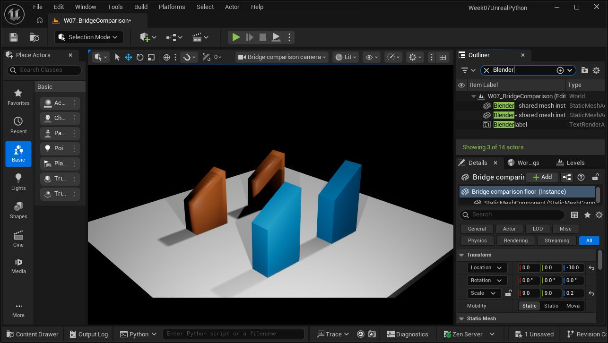
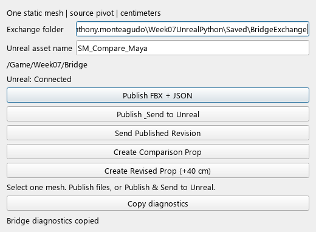

# Maya / Blender to Unreal: working comparison bridge

**Start here for a complete test run:** [Unified Unreal demo testing walkthrough](../../../Course/Slides/Week07/LiveTesting20261013/index.html#bridge), including both publishers, baseline/revision/reset commands and acknowledgement checks.

For the current step-by-step teaching route, open the [Maya publish–revise–verify walkthrough](../../../Course/Slides/Week07/MaterialsWalkthrough20261013/maya.html) and [manual/API material comparison](../../../Course/Slides/Week07/MaterialsWalkthrough20261013/walkthrough.html). These complement the implementation comparison below. The Maya page is a written rehearsal guide, not a new live UI recording.

Two source applications, one FBX + JSON contract, one Unreal receiver.
Both publishers have **Publish files**, **Publish & Send**, and **Send published
revision** actions. Unreal acknowledges the actual imported asset or an error.

Both publishers also offer **Copy diagnostics**. It copies a JSON report to the
clipboard: host and Python versions, loaded bridge module, active/configured
exchange folders, receiver project/session and heartbeat, manifest, pending or
last request ID, result and status message. Missing or unreadable records remain
visible in the report. It does not inspect selection, export, send, poll away a
pending acknowledgement, or modify exchange files. A result received before the
normal UI poll can appear beside a still-pending local ID; the report is a
snapshot of both states. The last result remains available after the UI consumes
the acknowledgement, until a new publish or exchange change clears that context.

Use it before retrying a blocked/pending operation, and attach it to reproduction
steps. Compare receiver project/session and exchange paths before diagnosing the
asset itself. Review local paths before sharing the report. Clipboard success is
reported separately and does not replace the operation's status. Reload the tool
in each host to pick up this added control; a previously open UI uses old code.

Offline validation covers unchanged queue/files, offline/pending/failed/completed
states and malformed records. The Maya offscreen check also clicks the button
and checks the clipboard. These checks do not establish live import readiness.

Start with the [side-by-side implementation walkthrough](parity.html) for the
shared execution path, annotated host differences, recovery behavior and a
matched classroom exercise. Both tools instantiate the same `Publisher` class;
there are not two copies of the publishing pipeline.

This is a real, same-machine connection through a shared folder. The Unreal
editor polls explicit requests on its main thread. It is not automatic change
detection, a live animation stream, or a network service. Publishing a revision
updates the mesh asset and therefore its existing placed instances.

## Start the classroom comparison

Use the existing `Week07UnrealPython.uproject` with Unreal 5.7.4. No additional
Unreal plugin is needed beyond the already-enabled Python and editor scripting.

1. **Unreal:** open `/Game/Week07/Bridge/W07_BridgeComparison`. It contains two
   instances of the Blender mesh and two of the Maya mesh. In **Output Log >
   Python**, run:

   ```python
   from week07_bridge import unreal_receiver
   unreal_receiver.install_menu()
   unreal_receiver.start()
   ```

   The native **Tools** menu then has **Start FBX Bridge Receiver** and **Stop FBX
   Bridge Receiver**. Start is explicit each editor session. Importing the module
   alone does nothing. The exchange path is printed in the Output Log.

2. **Blender:** open [BridgeCompare.blend](../../Samples/Bridge/BridgeCompare.blend).
   In the Text Editor, open `Scripts/bridge/open_blender.py` from this project and
   choose **Run Script** (Alt+P). In the 3D View, press **N**, choose **Week 7**.
   Select the wedge in **Object Mode**, leave the asset name `SM_Compare_Blender`,
   then choose **Publish & Send to Unreal**. Wait for **Imported:**.

3. **Maya:** open [BridgeCompare.ma](../../Samples/Bridge/BridgeCompare.ma).
   In its Python Script Editor, run the launcher using its full local path:

   ```python
   import runpy
   runpy.run_path(r"C:/path/to/Week07UnrealPython/Scripts/bridge/open_maya.py")
   ```

   On the instructor's current machine, the project root is
   `C:/Users/antho/Perforce/anthony.monteagudo_TechArt/anthony.monteagudo/Week07UnrealPython`.
   Select the mesh transform, leave `SM_Compare_Maya`, and **Publish & Send**.

4. **Revise:** raise the roof vertices in either source application and publish
   again under the same asset name. Both corresponding Unreal instances update.
   The prepared revised scenes raise the roof by **40 cm**, changing height from
   **180 cm to 220 cm**. Open those scenes, rerun the launcher if needed, and send
   them for a reproducible fallback. Re-publish the baseline scene to reset.

The exchange defaults to `Saved/BridgeExchange` inside this project. When code
and Unreal live in different folders, set the **same absolute exchange path** in
both publishers and pass it to `unreal_receiver.start(r"C:/that/folder")`.

## Physical examples

| Source | Baseline | Revised |
| --- | --- | --- |
| Blender | [BridgeCompare.blend](../../Samples/Bridge/BridgeCompare.blend) | [BridgeCompare_Revised.blend](../../Samples/Bridge/BridgeCompare_Revised.blend) |
| Maya | [BridgeCompare.ma](../../Samples/Bridge/BridgeCompare.ma) | [BridgeCompare_Revised.ma](../../Samples/Bridge/BridgeCompare_Revised.ma) |

The wedge is 120 x 60 x 180 cm with a floor-level origin and a roof sloping
down toward +X. All geometry comes from the shared `fixture.py` vertex list.
Blender creates a Z-up mesh in scene units. Maya maps the same points into its
Y-up scene in centimeters. These are course-authored meshes, not course assets
copied from Karol or the conference video.



Orange meshes are Maya's row; blue meshes are Blender's row. Each pair shares
one mesh asset. The Outliner labels identify each instance explicitly.
The UI capture also shows a shading difference between the host exports.
Dimensions and vertex positions are verified separately; smoothing and normal
policy are additional comparison points, not proof of a geometry mismatch.



Inspectable baseline/revised FBX + JSON examples are also under
`Samples/Bridge/Handoffs`. These are reference copies. Use Publish to generate
active revisions under the exchange folder.

## Compare these files, in this order

All source links are relative to this project, so the student package is movable.

| File | Teaching role | Shared? |
| --- | --- | --- |
| [core.py](../../Content/Python/week07_bridge/core.py) | Name/scope checks, revision folder, FBX hash, manifest | Yes |
| [client.py](../../Content/Python/week07_bridge/client.py) | Publish / send / acknowledgement actions | Yes |
| [transport.py](../../Content/Python/week07_bridge/transport.py) | Request files, session heartbeat, responses | Yes |
| [unreal_receiver.py](../../Content/Python/week07_bridge/unreal_receiver.py) | Validate contract, import settings, update and save | Yes |
| [blender_adapter.py](../../Content/Python/week07_bridge/blender_adapter.py) | `bpy` selection, evaluated mesh copy, FBX export | Blender only |
| [maya_adapter.py](../../Content/Python/week07_bridge/maya_adapter.py) | `maya.cmds`, duplicate/freeze copy, FBX export | Maya only |
| [fixture.py](../../Content/Python/week07_bridge/fixture.py) | One geometry definition, two scene constructors | Geometry shared |
| [blender_ui.py](../../Content/Python/week07_bridge/blender_ui.py) / [maya_ui.py](../../Content/Python/week07_bridge/maya_ui.py) | Native Blender sidebar / Maya PySide window | Host-specific UI |

The adapter interface is only:

```python
info = adapter.inspect_selection()
adapter.export_fbx(output_path)
```

Both UIs call the same `Publisher`. Students can also bypass the UI:

```python
from week07_bridge.client import Publisher
from week07_bridge.blender_adapter import BlenderAdapter
publisher = Publisher(BlenderAdapter())
publisher.publish("SM_Compare_Blender", send=True)
# In Maya, replace the import/class with MayaAdapter. Everything else is the same.
# Poll later without blocking the application's UI thread:
publisher.poll()
print(publisher.message)
```

## What actually changes between hosts?

| Concern | Blender | Maya |
| --- | --- | --- |
| Selection | One mesh object in Object Mode | One mesh transform, no component selection |
| Geometry at export | Evaluated dependency graph includes modifiers | Duplicate evaluated mesh, delete duplicate's construction history |
| Preparation | Bake world rotation/scale into temporary mesh vertices | Freeze transforms on a temporary duplicate |
| Pivot | Source object origin becomes FBX origin | Source rotate pivot becomes FBX origin |
| Units | Convert scene unit scale into centimeter geometry | Require centimeter working units |
| Axes | Z-up, FBX forward -Y | Maya Y-up dimensions reordered to Z-up; FBX exporter writes Z-up |
| FBX call | `bpy.ops.export_scene.fbx` | Maya FBX plugin through MEL |
| UI and polling | Native sidebar/operators and `bpy.app.timers` | PySide6 dialog and `QTimer` |
| Artist state | Restore selection, active object, unit settings; discard copy | Restore selection, FBX settings, undo recording, modified flag; discard copy |

Neither adapter applies modifiers or deletes history on the original source.
World placement is deliberately excluded: Unreal Actors own placement. The
source object's orientation and scale are baked into the published geometry.
The geometry contract is shared, not the FBX bytes. Host metadata, triangulation
and smoothing may differ. This is a static-mesh publishing comparison, not a
promise of identical shading or support for every scene arrangement.

### Shared action and recovery behavior

| Action or condition | Both publishers |
| --- | --- |
| Publish FBX + JSON | Inspect, validate, export a new immutable revision, write manifest. No import request. |
| Publish & Send to Unreal | Publish, then queue that manifest for the active receiver session. |
| Send Published Revision | Send the last successful local publish without exporting again. |
| Acknowledgement pending | Block another publish/send until the response arrives; inspect Unreal if stalled. |
| Failed new export | Clear the sendable selection so Send cannot accidentally submit an older mesh. Old files remain on disk. |
| Receiver offline after export | Keep the successful revision; start the receiver, then Send Published Revision. |
| Change exchange folder | Clear local revision/request tracking and require a new publish. This does not cancel a request already queued in the old folder. |

Both UIs call `Publisher.set_exchange()`, `publish()`, `send()` and `poll()`.
The shared `connected` property reads the same receiver heartbeat. UI-specific
timers keep polling without blocking the host. Asset name and destination, not
the source application or revision ID, determine which Unreal asset updates.

## The inspectable handoff

Each publish creates an immutable revision folder:

```text
Saved/BridgeExchange/
  publishes/SM_Compare_Blender/<revision>/
    SM_Compare_Blender.fbx
    manifest.json
  requests/<request-id>.json
  responses/<request-id>.json
  receiver.json
```

The manifest includes `schema_version`, `source_file`, `source_host`, `asset_name`,
`destination_path`, relative `filename`, dimensions, revision ID and FBX hash.
The FBX is completed before JSON is committed. A send request references this
manifest. Unreal verifies the hash, imports the mesh, checks dimensions, saves
the asset, then acknowledges. No executable code travels through the request.

These concrete field names implement the earlier run sheet's proposed FBX + JSON
contract. No older implemented receiver was found in the workspace. Both adapters
now use this one receiver, which has no Maya/Blender import branches.

## Student comparison exercise

1. Publish both baseline scenes. Predict which fields differ in their manifests.
2. Read the two `inspect_selection()` functions beside one another. Identify the
   host calls and the ordinary Python data returned to the shared core.
3. Change one roof in Blender. Predict what updates in Unreal and what stays put.
4. Change one roof in Maya. Repeat the same observation using the same receiver.
   In the supplied Blender scene move the upper four vertices +0.4 on Z
   (meters); in the supplied Maya scene move them +40 on Y (centimeters).
   Keep the asset name unchanged. Each pair should measure 220 cm tall at unit
   Actor scale, with the same Actor transforms and existing material overrides.
5. Try no selection. Then stop the Unreal receiver and try Publish & Send.
   Explain why a successful export is different from a successful import.
6. Restart the receiver and choose **Send published revision**. No second export
   is needed. Inspect the request and acknowledgement files.
7. Optional: publish the Maya mesh under `SM_Compare_Blender`. Both Blender-row
   instances now use Maya's revision. Explain why the receiver did not change.

## Boundaries and recovery

- Tested with **Blender 5.1.1, Maya 2027, Unreal 5.7.4** on this Windows machine.
  Other host versions are not certified. Maya UI uses PySide6.
- One static polygon mesh per publish. Armatures, skin, blend shapes, mirrored
  transforms, zero-size geometry and child-transform hierarchies in Maya are
  rejected. No rig, animation, collision generation, texture or shader transfer.
- Imports are restricted to `/Game/Week07/Bridge`. An existing asset without the
  bridge ownership tag is rejected, even within that folder.
- Keep material slot layout stable. Existing mesh material assignments and Actor
  component overrides survive the demonstrated reimport. New shaders are not built.
- The receiver temporarily selects the legacy FBX importer, then restores the
  Interchange FBX flag. This keeps the lesson's import options predictable.
- An import is not an Undo transaction. A post-import verification/save error may
  leave the in-memory asset changed. Correct and republish, or send a known-good
  prior manifest. Source revisions remain available in the exchange folder.
- If Unreal stops responding, the publisher reports pending acknowledgement.
  Check the Unreal log and response file before resending. Restarting the editor
  gives a new session token; old queued requests are rejected rather than replayed.
- Imports save only the imported asset. They do not create Actors or save the map.
  `prepare_bridge_demo.py` is a separate explicit fixture builder.

## Verification and development

[verification.json](verification.json) records the performed checks. The real
integration tests verified the imported vertex positions (including slope
direction and floor pivot), dimensions, same asset path, two instances updating,
and preservation of an Actor's material override. Four real DCC sends received
Unreal acknowledgements. Adapter checks verified source state survives exporting
transformed geometry, including a Blender modifier.

The student ZIP was also extracted into a separate project and opened in Unreal.
Its own Python modules loaded, all four placed instances were present, both
packaged revised FBXs reimported, and the mesh-level color materials survived.
Native Blender UI registration and offscreen Maya PySide rendering were checked.
The Blender UI workflow was rehearsed on 13 October 2026: native Publish & Send,
Edit Mode roof selection with X-ray, a +40 cm Z move, and another Publish & Send.
Both existing Unreal instances updated from 180 to 220 cm. The original baseline
scene is unchanged; `Samples/Bridge/BridgeCompare_UI_Rehearsal.blend` holds the
saved UI edit. This does not establish a complete Maya UI rehearsal.
`Samples/Bridge/UI-Rehearsal/publishes` preserves the two actual UI-produced
FBX/JSON revision pairs with their original hashes. Both manifests record the
baseline filename because the second publish preceded Save As; the mesh edit
was in memory at that point. These are evidence copies, not the active inbox.
See [actual captures, slide proposal and Karol download review](../../../Course/Slides/Week07/BridgeRehearsal20261013/index.html)
and `UI-Rehearsal/verification.json`. The animated capture is a sequence of actual
UI stills, not continuous video. The editor/map is left in the revised state;
publish the baseline first when repeating the demonstration.

Ordinary Python checks from the project root:

```powershell
.venv/Scripts/python.exe Scripts/dev.py check
.venv/Scripts/python.exe Scripts/dev.py test
```

`Scripts/bridge/build_samples.py` runs in separate background Blender/mayapy
processes. `Scripts/editor/bridge_smoke_test.py` runs in a separate Unreal editor.
`bridge_live_test.py` keeps that editor alive while `live_publish_test.py` sends
from the two real DCC processes. These scripts intentionally create/save test
assets. They are not startup hooks and should not run in an artist's active scene.

## Inspiration and attribution

The starting classroom concept is the existing Week 7 `Bridge_and_UX.html` run
sheet: selection, FBX + manifest, controlled import, revise, same-asset update.
The Northwood / Week 7 project's Isaac Oster provenance remains unchanged.

Karol Kowalczyk / Tech Art Corner's course material was consulted locally:
`Downloads/Python.zip`, specifically `batch_fbx_import.py`, `remote_import_fbx.py`
and `remote_control_demo_functions.py`, plus the instructor's lessons 19 and 44
notes. These establish task/options/import and structured remote-call patterns.
This implementation is independently written; the paid course archive and its
scripts are not redistributed in the student package.

The supplied [Blender Conference character-workflow video](https://www.youtube.com/watch?v=5Liq0JckHqA)
is broader context, not a claim that this static-mesh demo reproduces its character
rigging/animation workflow. [Epic's Send to Unreal](https://epicgames.github.io/BlenderTools/send2ue/)
is another one-click publishing reference. This bridge remains a small teaching
implementation whose shared code students can inspect.
