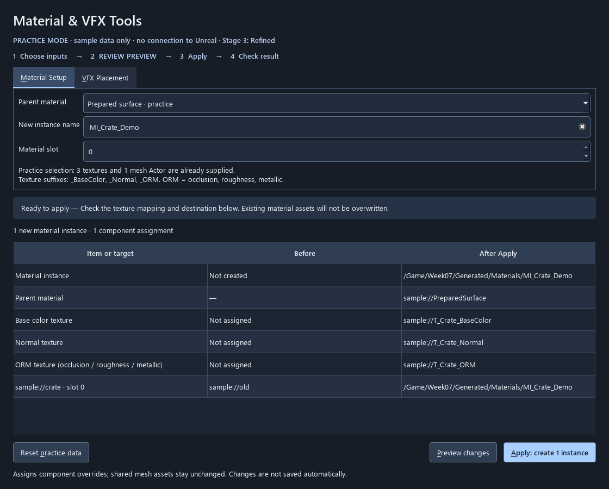
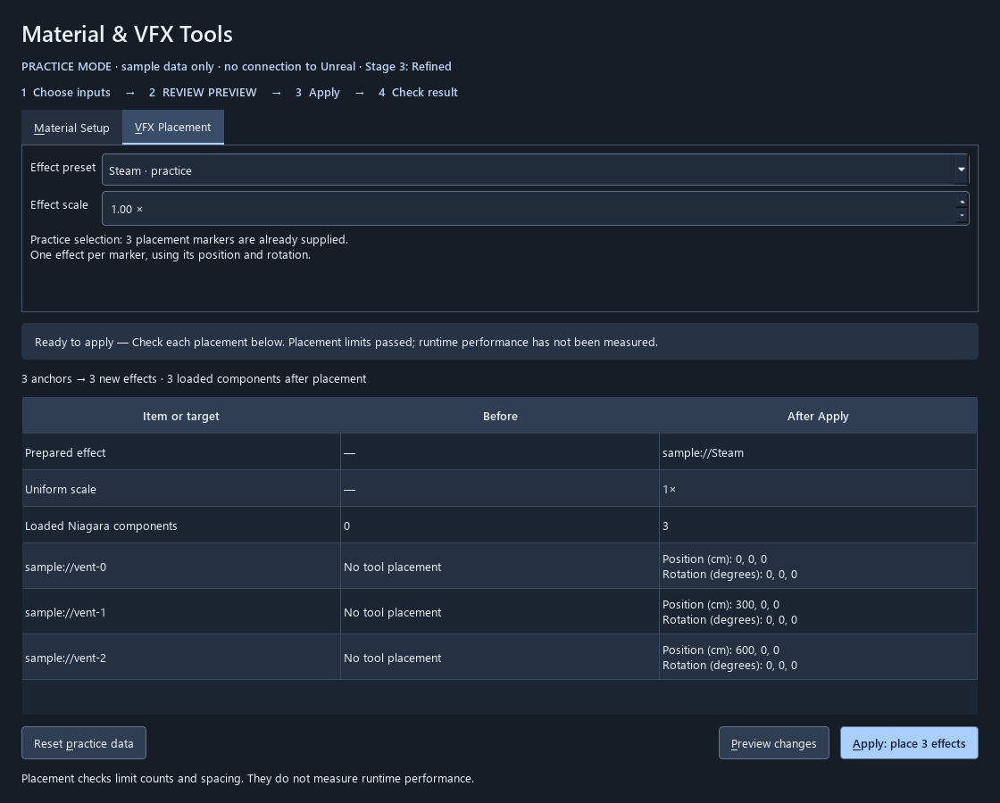

# Selected demo tools · 12 October 2026

For students, use [the guided tasks](../Students/START_HERE.md).
For delivery, use [the instructor presentation checklist](PRESENTATION_CHECKLIST.md).
This document describes implementation scope and limitations.

The instructor selected **Material Setup Assistant** and **VFX Placement Tool**.
No procedural scattering or material/Niagara graph manipulation is in scope.
VFX validation is a small set of placement safeguards, not a scene-cost inspector.

## What is implemented in code

- Pure preview/validation rules and a session that consumes each reviewed plan once.
- Separate PySide tabs for both workflows, with input-change invalidation and an
  explicit acknowledgement for density warnings.
- An offline backend with fictional assets, for teaching and UI tests.
- Live Unreal adapters for instance creation/component assignment and Niagara
  placement. Rehearsed on the prepared UE 5.7.4 fixture; see [recorded evidence](../../../Course/Slides/Week07/FinalClass20261013/live-captures/rehearsal.json).
- A Qt-free Python bridge used by the implemented C++ Slate tab in `Plugins/Week07Tools`. EUW remains an alternative architecture.

The earlier Prop Inspector remains a reference/fallback. The new selected tools
are separate workflows; they do not repurpose its six-prop renaming command.

## Material Setup: deliberately narrow

Select one complete texture set in the Content Browser, named with a shared prefix
and suffixes `_BaseColor`, `_Normal`, `_ORM`. Select the destination mesh Actors in
the level. The first version accepts exactly one Static Mesh Component per Actor
and one explicit slot index, avoiding ambiguous component/slot assignment.

Choose a named prepared parent from the dropdown, configured by the instructor with
texture parameters `BaseColorTexture`, `NormalTexture`, `ORMTexture`.
The tool creates one new material instance under
`/Game/Week07/Generated/Materials`, sets those parameters and assigns component
overrides. The live catalogue contains the prepared classroom blue-surface parent under `/Game/Week07/LiveDemo/Materials`. Its three texture bindings were checked in the recorded fixture rehearsal. Students
choose its readable label rather than entering an asset path.

Missing/ambiguous sets, incompatible selections, missing parent parameters, wrong
sRGB settings and a non-normal-compressed Normal map block Apply. Shared textures
are not silently reconfigured. The prepared parent defines the ORM channel
convention (R=occlusion, G=roughness, B=metallic); the tool does not infer or rewire it.

No existing material instance is overwritten. No master graph, shared mesh asset,
or texture is edited. Nothing is automatically saved. Component assignments use
an Undo transaction; **creating an asset is not promised to be reversed by the
same Undo step**. On failure, assignments are restored and any new draft asset is
reported for inspection rather than automatically deleted.

## VFX Placement: bounded marker placement

Select Actors tagged `W07_VFXAnchor`. Each receives one prepared Niagara System at
its position and rotation. Uniform scale is limited to 0.25–1.0. No intensity,
spawn-rate, lifetime, emitter, graph or random-distribution controls are exposed.

The live catalogue is `Config/Week07ToolPresets.json`. Named choices appear in the
student dropdown only when configured (and reviewed, for effects). Its example `steam_demo` is
intentionally **unconfigured and unreviewed**. Live placement fails until the
instructor supplies a real asset and reviews the preset. The fictional offline
example is enabled only in the offline backend.

| Check | Behavior | Reason |
| --- | --- | --- |
| Reviewed preset and nonempty review note | Block unreviewed effects | The tool cannot infer an effect's cost from its asset name. |
| Real Niagara System with Effect Type assigned | Block if absent | Require a scalability configuration entry point; assignment alone is not proof of good settings. |
| Per-batch limit | At most 8; preset may be lower (starter: 4) | Prevent accidental large placement batches. |
| Per-system loaded count | At most 16 | Include pre-existing copies, not just this tool's Actors. |
| Total loaded Niagara component count | At most 32 | Include other effects/components in the loaded world. |
| Density review | Warn when projected loaded count exceeds 8; acknowledgement required | Encourage review before the scene becomes crowded. |
| Minimum spacing | 100 cm from selected and existing effect positions | Catch obviously piled-up placements; not a bounds/overdraw calculation. |
| Existing source-anchor tag | Block duplicate placement | Repeating Apply must not multiply effects at the same markers. |
| Fresh request/scene/preset snapshot | Recheck immediately on Apply | Changed selection, transforms, counts or preset metadata require a new preview. |

These numbers are **conservative classroom policy choices**, not Epic limits,
hardware-derived budgets or production certification. Policy constants are in
`workflows.py`; students cannot raise them with UI sliders. Existing effects are
not deleted to meet a limit. Effects in unloaded levels, runtime spawns, hidden
simulation dependencies, emitter/particle counts, screen coverage and GPU timings
are not measured. Asset graph changes require renewed review; snapshots do not
fingerprint graph contents or every dependency.

### Minimal preset review before enabling live placement

For the chosen system, check bounded spawn behavior and lifetime/steady-state
particle count, renderers/materials (especially translucent overdraw), bounds,
distance/visibility culling and instance scalability. Rehearse the expected worst
case placement count from a representative camera on the target machine. Record
the reviewed system, context and result in `review_note`, lower `max_new` if needed,
then set `reviewed_for_demo` true. Re-review after effect/material changes.

This is a short instructor preparation step for one prepared effect—not a new
student optimization assignment. A suitable teaching message is: **“Placement
checks passed; performance still needs measurement.”** Never label the result
“production-safe” or “optimized” based only on these checks.

New Actors carry `W07_PlacedVFX` and `W07_Source=<anchor path>` tags, and go into
`Week07/VFXPlacements`. A placement failure attempts cleanup only of Actors created
by that call and reports anything left. The batch uses one Undo transaction;
actual Undo/cleanup behavior remains an in-engine acceptance test. No map save.

## Run without interacting with Unreal

When you choose to open a window:

```powershell
./.venv/Scripts/python.exe Scripts/assistants.py
```

Code-only checks/captures, with no desktop window:

```powershell
./.venv/Scripts/python.exe Scripts/dev.py test
./.venv/Scripts/python.exe Scripts/ui_quality.py --stage 3
./.venv/Scripts/python.exe Scripts/assistants.py --render Docs/UI/captures
```

Live entry point **for a later manual rehearsal**: reload `week07_tools`, then
`w7.show_assistants()`. The adapter currently guards the Week 7 demo map and refuses
PIE. This is a teaching sandbox, not an unrestricted production scene tool.




## Native UI reuse

The future EUW can call `native_bridge.open_workflow_session()` and keep its String
ID. Through Execute Python Script pins, call `dispatch_workflow(session_id, action,
kind, request_json, warnings_reviewed)`. The result is a JSON String; unpack it in
the Python node to typed outputs for the widget. No executable code comes from
request data. Actions are `preview`, `apply`, `clear`; kinds are `material`, `vfx`.

Material request: `{"master":"/Game/...", "name":"MI_Name", "slot":0}`.
VFX request: `{"preset":"steam_demo", "scale":1.0}`.
Preview returns `plan`, `can_apply`, and `warning_ack_required`. The additional
`presentation` object supplies shared before/after rows, count summary and action
text for a consistent native UI. Enable Apply only
when the plan exists and any required warning acknowledgement is checked. Clear
the session on input/tab changes. Apply rechecks independently. Node execution
success is separate from returned `ok`. Close the session on widget destruction.
Native widget creation, docking, typed-pin conversion and live behavior are not
validated by the offline tests.

## Sources used for implementation boundaries

- [Epic MaterialEditingLibrary, UE 5.7](https://dev.epicgames.com/documentation/en-us/unreal-engine/python-api/class/MaterialEditingLibrary?application_version=5.7): prepared instance parameter operations.
- [Epic NiagaraComponent, UE 5.7](https://dev.epicgames.com/documentation/en-us/unreal-engine/python-api/class/NiagaraComponent?application_version=5.7): system assignment.
- [Epic Niagara scalability, UE 5.7](https://dev.epicgames.com/documentation/en-us/unreal-engine/scalability-and-best-practices-for-niagara?application_version=5.7): effect types and the limits of counting systems as a performance proxy.
