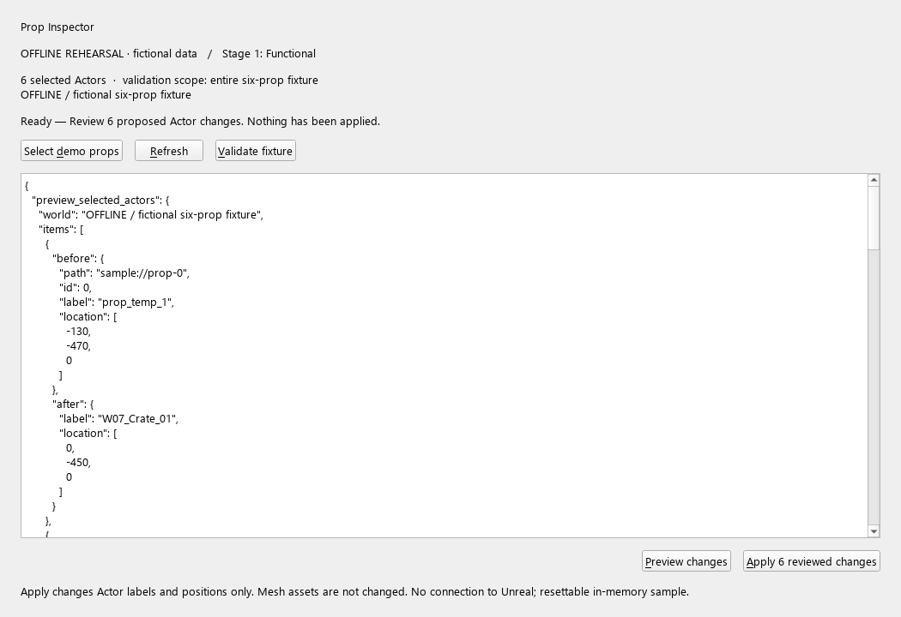
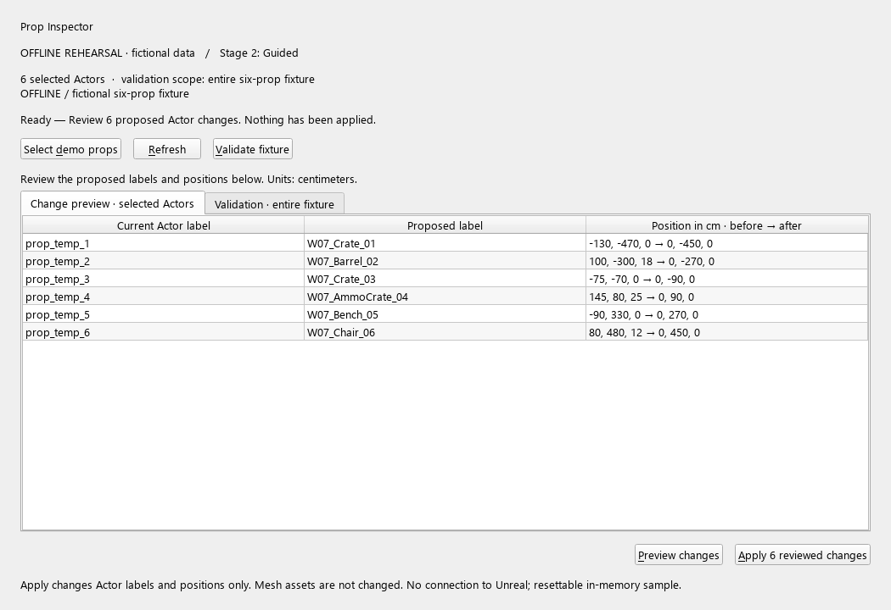
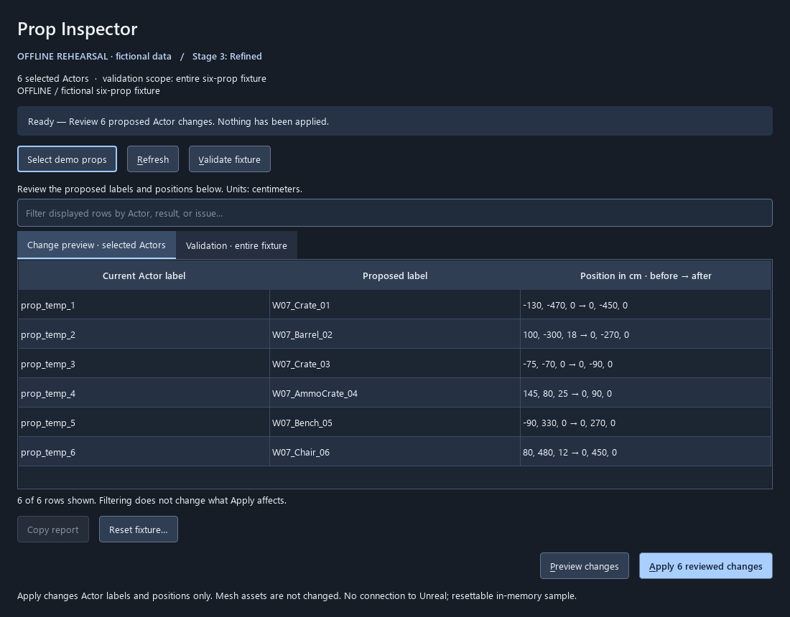
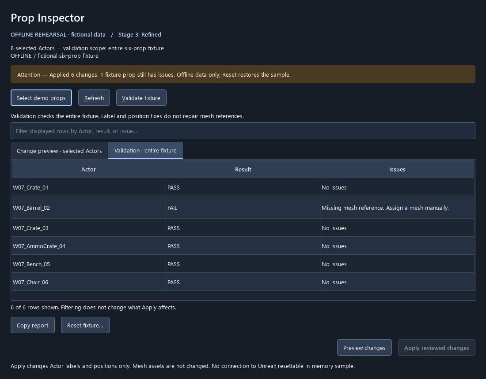

# Prop Inspector · UI and functionality status

The selected classroom workflows are now [Material Setup and VFX Placement](MATERIAL_VFX_SCOPE.md).
This page retains the earlier Prop Inspector as a reference. The current class
[UI progression uses Material/VFX themselves](../../lesson_materials/week_07_unreal_python/stage_05_ui_progression/README.md).

**Two-interface direction:** this guide covers the actual **PySide6 Qt Widgets**
tool, not a web UI. The required native Unreal tab is a separate interface; see
[the native UI investigation and assembly specification](UNREAL_NATIVE_UI.md).
The existing parented Qt window is not the native-tab implementation.

This is a working, fixture-specific Python tool with a new staged PySide6 interface.
The existing backend inspects selection, validates the six props, previews Actor
label/placement changes, applies a reviewed plan in one Undo transaction, resets
the baseline, and exports selection reports. It is not a general asset pipeline.

**Current readiness:** the console backend has saved evidence of 12 passing Unreal
integration checks on 5.7.4 (`Saved/Tooling/Checks/20261010_184405_265596/result.json`).
The new UI has offline controller/widget tests and offscreen captures. Its live
Unreal adapter and window/event-loop integration are implemented but **not yet
rehearsed inside Unreal**. Do not describe the new UI as classroom-ready until the
live acceptance gate below passes. No editor or desktop window was opened during
this code preparation.

## Try the UI when you choose

For this earlier reference only, run from the project root:

```powershell
./.venv/Scripts/python.exe Scripts/ui.py --stage 3
```

This opens a standalone **OFFLINE REHEARSAL** window using invented six-prop data.
Select demo props → Preview changes → inspect before/after → Apply. The sample
intentionally has one missing mesh, so successful label/placement repair still
leaves one validation failure. Reset restores sample labels/positions. No remote
connection to Unreal exists. Stages 1 and 2 use the same command with another number.

For a later, instructor-controlled **live** rehearsal, on the saved demo map in
Unreal's Python console:

```python
import week07_tools as w7
# If w7 was already imported before the UI code was added:
import importlib
importlib.reload(w7)
w7.reload_tools()
w7.show_pyside_ui(stage=3)
```

`w7.close_ui()` closes the panel. Repeated `show_ui()` reuses the current panel;
changing stages replaces it. `reload_tools()` now closes the panel and removes its
callbacks, then reloads UI code. Reopen explicitly and create a fresh preview.
This is an external Qt window parented to Unreal, **not a native dockable Slate or
Editor Utility Widget tab**. Qt events are pumped from Slate; no blocking Qt event
loop is started inside Unreal.

## The three UI/UX stages

| Stage | Implementation to read | What changes and why | Promotion gate |
| --- | --- | --- | --- |
| 1 · Functional | `ui/views.py`: `FunctionalView`; `ui/controller.py` | Buttons replace console calls; read-only JSON exposes real data. Visible mode/scope/status and safe Apply already exist. | Operations work, errors appear, preview never edits, stale/empty plans cannot apply. |
| 2 · Guided | `ui/views.py`: `GuidedView` | Compare current/proposed values in a table; separate selected-Actor preview from whole-fixture validation. Reduces JSON decoding and scope ambiguity. | A user can identify what changes, which objects are affected, and what remains invalid. |
| 3 · Refined | `ui/views.py`: `RefinedView`; `ui/window.py` | Stronger hierarchy, restrained emphasis on Apply, explicit change count, filter, report copying, separate reset with Cancel default, focus indicators and text status. | Filtering cannot silently narrow Apply; controls fit, recovery is understandable, keyboard flow and live lifecycle work. |

Paths in this table are beneath `Content/Python/week07_tooling/`. These are real
presentation implementations sharing one controller, not three independent copies
of the mutation logic. Safety is not a late-stage enhancement. All stages are
available for comparison; gates govern teaching/release readiness, not a runtime
unlock mechanic. The lab and slide order remain provisional.

## Quality gates and evidence

```powershell
./.venv/Scripts/python.exe Scripts/ui_quality.py --tool props --stage 1
./.venv/Scripts/python.exe Scripts/ui_quality.py --tool props --stage 2
./.venv/Scripts/python.exe Scripts/ui_quality.py --tool props --stage 3
```

Each command runs cumulative automated checks, offscreen. Missing Qt fails the
gate. Stage 3 covers the original 13 controller/widget checks plus the material/VFX
policy tests and assistant UI workflow check. The full `dev.py test`
suite also runs these tests, but skips widget tests on machines without Qt; use the
explicit gate command when assessing UI readiness.

| Evidence | Status |
| --- | --- |
| Existing console/backend UE integration | Previously passed 12 checks; not rerun during code-only work. |
| New controller and Qt widget behavior | Automated offline checks available and run locally. |
| Offscreen layout/captures | Generated from actual Qt widgets; see gallery below. |
| Native Windows keyboard/DPI/screen-reader review | Pending manual review; no accessibility certification implied. |
| Live Unreal parenting, focus, event loop, Undo, reload/close | Pending instructor-controlled rehearsal. |
| General-purpose tools / asset import / finalized student lab | Not implemented by this UI work. |

Before presenting the final stage as complete, manually verify: opening twice
doesn't duplicate windows; selection changes disable Apply; wrong map/PIE show a
recoverable error; preview does not edit; applying selected props is one Undo step;
Undo re-invalidates the plan; validation describes remaining issues; closing and
reloading remove old callbacks; Tab/Alt shortcuts work; 100%/150%/200% scaling and
narrow widths remain readable. This checklist is documentation for later, not an
instruction to interrupt the current editor session.

## Captures for slide preparation

These are **offline UI captures**, not evidence of Unreal integration. The mode
label is intentionally visible. They can be regenerated without a desktop window:

```powershell
./.venv/Scripts/python.exe Scripts/ui.py --stage 3 --render Docs/UI/captures
```

### 1 · Functional: expose data and actions



### 2 · Guided: make comparison and scope readable



### 3 · Refined: hierarchy, feedback and recovery



### Verify: a successful repair can still leave another issue



## Dependencies and extension points

Qt Widgets is supplied by pinned `PySide6-Essentials==6.8.3` and `shiboken6==6.8.3`,
installed locally in ignored `.deps/ui`. These modules support the project's Python
3.11 environment. No packages were installed into the engine. On another machine:

```powershell
./.venv/Scripts/python.exe -m ensurepip
./.venv/Scripts/python.exe -m pip install --target .deps/ui -r requirements-ui.txt
```

The core rules and console tool still need only Unreal/the standard library.
`ui/dependencies.py` explicitly adds `.deps/ui` only when needed. The Unreal stub
remains analysis-only. Never copy another Qt distribution into this folder or mix
bindings in the same editor process. Preserve the packages' bundled license files
if distributing dependencies; they are not checked into the course project here.

- `ui/controller.py`: workflow and invalidation, independent of widgets and Unreal.
- `ui/offline_backend.py`: disposable data for rehearsal/tests; no fake engine APIs.
- `editor/ui_backend.py`: connects the panel to the existing guarded tool functions.
- `ui/views.py`: staged result presentation; `ui/window.py`: action wiring and styles.
- `ui/host.py`: explicit live window lifecycle and Slate event pumping.
- `Scripts/ui.py`: ordinary Python UI runner and headless captures.

The UI exposes select, refresh, validate, preview, apply, copy-validation-report and
reset. Actor/component inspection and file export remain available through the
existing console API; the panel does not yet include a component inspector or file
export dialog. No startup hook, watcher, remote-execution server or automatic asset
saving was added.

API references: [Epic's Unreal 5.7 Python module](https://dev.epicgames.com/documentation/en-us/unreal-engine/python-api/module/unreal?application_version=5.7)
documents external-window parenting and Slate callbacks; [Qt for Python setup](https://doc.qt.io/qtforpython-6.8/gettingstarted.html)
documents installation and its supported Python baseline. The pinned runtime was
verified locally for offline widgets; that does not verify Unreal hosting.
