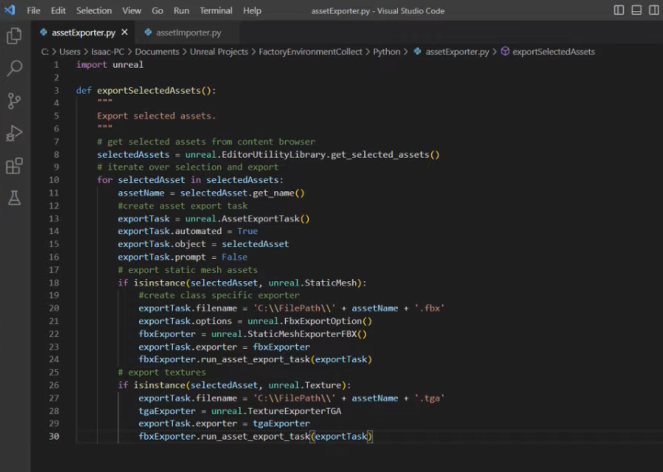
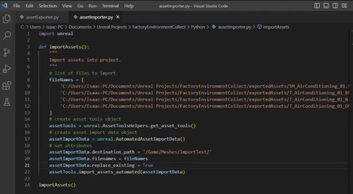
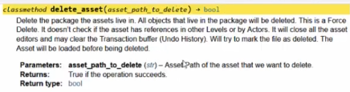
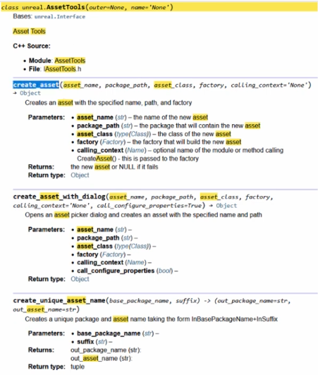

# Oster asset setup notes

Refined study notes for the three supplied Asset Setup lessons, with the import/export prerequisite identified separately. Original notes, code and captures are preserved.


## Asset Setup 01 — identify the imported assets

Isaac Oster’s first setup lesson connects import automation to a specific editing task: find the imported meshes and textures, then prepare them for material-instance creation. The important idea is **operation scope**. A destination folder can contain useful existing assets as well as the assets involved in the current import.

### Where this lesson fits

The supplied notes are the three-part **Asset Setup** series. This first lesson extends Oster’s earlier two-part **Asset Import / Export** series. The opening captures show that earlier exporter and importer, but the transcript mainly develops asset discovery and classification. Keep the prerequisite recap separate from the new setup work.

The complete workflow is:

**Source files → imported mesh and textures → material slots → material instance → parent and texture parameters → assignment → save and inspect.**

The demonstration assumes prepared assets, a naming convention and a parent material with texture parameters. Importing files alone does not establish those relationships.

### Prerequisite recap: export and import

The exporter starts from the Content Browser selection. Each selected object is assigned to an `AssetExportTask`; the object’s class determines a suitable format and exporter. The captured example uses FBX for static meshes and TGA for textures. Selecting a mesh does not, by itself, select all its texture dependencies for this loop.



The importer creates an `AutomatedAssetImportData` object with a destination content folder and source filenames, then calls `AssetTools.import_assets_automated`. The captured revision enables `replace_existing`. That permits replacing existing assets; it is a consequential policy choice, not a prerequisite for every batch importer.



**Capture-level correction:** the texture branch in the exporter image invokes `fbxExporter.run_asset_export_task` even though `fbxExporter` is created inside the static-mesh branch. A texture-only selection could reach an undefined variable. The unambiguous API call is `unreal.Exporter.run_asset_export_task(export_task)`, with the intended exporter stored on the task. Inspect the returned result and task errors. This is a correction to the captured snippet, not evidence that a revised exporter was run.

### Keep three kinds of path distinct

| Kind | Example | Used for |
| --- | --- | --- |
| Source file on disk | `C:/Art/Exports/SM_AirConditioning_01.fbx` | Importing an external file |
| Unreal package path | `/Game/Meshes/SM_AirConditioning_01` | Referring to an asset package |
| Unreal object path | `/Game/Meshes/SM_AirConditioning_01.SM_AirConditioning_01` | Referring to an object inside its package |

A content directory such as `/Game/Meshes/ImportTest` is also different from a physical `Content` directory on disk. The tutorial manually converts a copied project-content path to a `/Game` reference. Treat that as a demonstration for this project, not a general conversion rule for plugin or engine content.

The source removes the object suffix with `asset_path.split('.')[0]` after encountering a path-conversion warning. **Do not teach that dotted object paths are universally invalid.** The project’s UE 5.7 API describes both package and object forms. Use the form required by the particular API and identify the cause of an actual warning; never apply this string operation to arbitrary filesystem paths.

### The tutorial’s discovery method

1. Accept `folderPath` and `fileNames` from the importer.
2. List assets in the destination folder.
3. Load each candidate asset.
4. Read its import metadata, when available.
5. Compare the recorded source filename with the import’s source filenames.
6. Collect static meshes and textures into separate lists.

This is more selective than editing everything in a folder. It still identifies assets associated with a source file, not necessarily assets newly created during this run. Existing assets can have the same recorded source, and a reimport may update them.

`EditorAssetLibrary.list_assets` searches recursively by default in the project’s API. Set `recursive=False` when the intended scope is one folder. A content folder is an organizational boundary; it is not proof that every object inside belongs to this operation.

### Import metadata is conditional

For a supported asset, `asset.get_editor_property('asset_import_data')` can expose an `AssetImportData` object. `get_first_filename()` retrieves its first source filename. The project stub describes that return as absolute, even if an editor panel displays a relative source path.

Check the asset and metadata before calling methods on them. Distinguish “no usable metadata” from “unexpected error while reading metadata.” The tutorial’s `except AttributeError: pass` can hide a useful diagnostic and does not handle every possible property-access failure.

Avoid the blanket rule that materials never have import metadata: the current `MaterialInstanceConstant` API exposes an `asset_import_data` property, although it may be unset or unhelpful for this task. Property availability and actual source data are separate questions.

For a comparison based on filenames, normalize the source-file paths consistently with the operating system. Multiple source files, moved files and renamed inputs require an explicit policy; the first filename is not a complete provenance record for every asset type.

### A clearer way to retain operation scope

**Supplemental improvement:** keep the objects returned by the import operation instead of rediscovering them by scanning the folder. The project’s `import_assets_automated` API returns successfully imported objects. Filter those returned objects by class and carry them into the next stage.

This Unreal-editor example defines a small import function; calling it performs an import. It illustrates scope transfer, not a complete importer or rollback system. Paths and import settings still need project-specific validation.

```python
import unreal

def import_prepared_files(file_names, destination):
    data = unreal.AutomatedAssetImportData()
    data.set_editor_property("filenames", list(file_names))
    data.set_editor_property("destination_path", destination)
    data.set_editor_property("replace_existing", False)

    tools = unreal.AssetToolsHelpers.get_asset_tools()
    imported = tools.import_assets_automated(data)
    meshes = [obj for obj in imported
              if isinstance(obj, unreal.StaticMesh)]
    textures = [obj for obj in imported
                if isinstance(obj, unreal.Texture)]
    return meshes, textures
```

This variant deliberately defaults to no replacement. It does not silently reproduce the demonstration’s overwrite setting.

If using Karol’s `AssetImportTask` approach, read each completed task’s `get_objects()` or `imported_object_paths`. The result can contain newly created **or updated** objects. In UE 5.7, `result` is deprecated in favor of `get_objects()`; asynchronous completion also matters. Interchange can use different naming/options behavior, so the two importer styles should not be treated as identical. [Epic AssetImportTask reference](https://dev.epicgames.com/documentation/en-us/unreal-engine/python-api/class/AssetImportTask?application_version=5.7)

### What the lesson establishes

The lesson finishes with classified meshes and textures ready for setup. It does not yet establish a valid parent, an unambiguous texture-to-mesh mapping or correct material assignment. Those decisions belong to the next stages.

**Course application:** connect this to the distinction between prepared inputs and reviewed scope. Ask students why a folder scan is broader than an operation result, and why “import succeeded” is not the same as “the asset is ready to use.”

**Review question:** if the destination contains an older mesh imported from the same file, how would the source-metadata filter distinguish it from this operation’s result?

### References

- [Oster: Asset Setup with the Unreal Python API](https://dev.epicgames.com/community/learning/tutorials/xrnE/unreal-engine-asset-setup-with-the-unreal-python-api)
- [Oster: Asset Import / Export using Unreal Python API](https://isaacoster.artstation.com/projects/Dvdrke)
- [Epic EditorAssetLibrary reference, UE 5.7](https://dev.epicgames.com/documentation/en-us/unreal-engine/python-api/class/EditorAssetLibrary?application_version=5.7)
- Local project-generated API signatures and the supplied captures support the version notes; the examples have not been executed in Unreal during this refinement.


[All original captures for this lesson](notes/01.html)


## Asset Setup 02 — inspect material slots and create instances

The second lesson moves from identifying imported assets to creating a material instance for each intended mesh slot. Its strongest teaching contribution is the relationship between **slot metadata, material objects, asset classes and factories**.

The demonstration removes an imported default material so its name can be reused. Preserve that as a description of the tutorial’s approach, while separating it from a general recommendation for a reusable tool.

### Read the static mesh’s material slots

`StaticMesh.static_materials` is an array of `StaticMaterial` structures. A structure exposes named properties; it is **not a Python dictionary**, even if its printed representation resembles one.

| Value | Meaning |
| --- | --- |
| Array index | The numeric slot used by `StaticMesh.set_material` |
| `material_slot_name` | The slot’s semantic name |
| `material_interface` | The material object currently assigned to that slot |
| `imported_material_slot_name` | Imported slot metadata; retain it when discussing import/reimport behavior |
| `uv_channel_data` | Texture-streaming-related UV data, outside this lesson’s editing task |

The slot name and the assigned asset’s name are related in the example, but they are not interchangeable identifiers. Multiple slots or meshes may refer to the same material asset. A slot may also lack a usable material reference.

An FBX import can derive slot/material information from the DCC scene. The exact generated assets and names depend on the importer and its options; do not promise that every DCC material creates a new Unreal material on every import.

### Iterate with an explicit index

Use `enumerate` to keep the slot index attached to each record. The original code calls `.index(staticMaterial)` during iteration, which repeatedly searches the array and can select the first equal record when duplicate values occur.

This is a read-only inspection function for Unreal. It does not reassign or delete a material.

```python
import unreal

def describe_material_slots(mesh):
    if not isinstance(mesh, unreal.StaticMesh):
        raise TypeError("Expected a StaticMesh asset")

    slots = mesh.get_editor_property("static_materials")
    for index, slot in enumerate(slots):
        material = slot.get_editor_property("material_interface")
        name = str(slot.get_editor_property("material_slot_name"))
        path = material.get_path_name() if material else "<unassigned>"
        print(index, name, path)
```

Use this information to prepare a change plan: mesh identity, slot index/name, current material, proposed instance and reason for the replacement.

### MaterialInterface explains the accepted types

`MaterialInterface` is a common base used by materials and material instances. A slot can therefore refer to a base material or an instance through the same interface. This is why the assignment API accepts a `MaterialInterface`, rather than only a concrete `Material` asset.

For the persistent editor asset created in this lesson, use `MaterialInstanceConstant`. A dynamic material instance serves a different use case; it is not a drop-in substitute for creating the same saved Content Browser asset with this factory.

### Understand the deletion step before adopting it

The tutorial retrieves the assigned material’s path and passes it to `EditorAssetLibrary.delete_asset`, then creates a replacement using the slot name. This illustrates asset deletion, but the returned reference does not prove that the material is disposable or exclusive to this import.



The current API describes this as force deletion: references elsewhere are not checked, and undo history may be affected. A Boolean result must be inspected. The lesson’s failed deletion and later clean retry do not establish a general explanation such as permissions or package corruption. [Epic deletion reference](https://dev.epicgames.com/documentation/en-us/unreal-engine/python-api/class/EditorAssetLibrary?application_version=5.7#unreal.EditorAssetLibrary.delete_asset)

**Recommended teaching adaptation:** create a distinct material instance, validate it, and reassign only the reviewed slots. Make removal of old assets a separate decision based on ownership and remaining references. If import settings can avoid generating unwanted materials in the first place, evaluate that for the chosen importer rather than deleting every discovered material afterward.

This also changes failure behavior: deleting first can remove a useful assignment before instance creation or texture setup succeeds. A sequence of successful calls is not an automatic transaction or rollback mechanism.

### Create the material-instance asset

Get the Asset Tools service through `unreal.AssetToolsHelpers.get_asset_tools()`. Its `create_asset` method needs the new name, destination folder, class and a factory object.



The class and factory have different roles:

| Argument | Example | Role |
| --- | --- | --- |
| `asset_name` | `MI_AirConditioning_01_Body` | Name of the new asset |
| `package_path` | `/Game/Meshes/ImportTest` | Destination content folder |
| `asset_class` | `unreal.MaterialInstanceConstant` | Type to create; pass the class |
| `factory` | `unreal.MaterialInstanceConstantFactoryNew()` | Creator object; construct an instance |

The lesson deliberately encounters both mistakes: passing the factory class without constructing it, and choosing a class the factory does not support. Refine those trial-and-error moments into a clear rule: **match the asset class to the factory, and pass an instantiated factory**.

This Unreal-editor example creates an unsaved instance when called. It does not set a parent, assign textures, modify a mesh or delete an existing asset.

```python
import unreal

def create_empty_instance(asset_name, destination):
    target = f"{destination.rstrip('/')}/{asset_name}"
    if unreal.EditorAssetLibrary.does_asset_exist(target):
        raise ValueError(f"Destination already exists: {target}")

    instance = unreal.AssetToolsHelpers.get_asset_tools().create_asset(
        asset_name,
        destination,
        unreal.MaterialInstanceConstant,
        unreal.MaterialInstanceConstantFactoryNew(),
    )
    if not isinstance(instance, unreal.MaterialInstanceConstant):
        raise RuntimeError(f"Material-instance creation failed: {target}")
    return instance
```

The destination and asset name still require project-specific validation. The existence check is a clear conflict policy for a teaching example, not a guarantee against concurrent changes.

### Naming and repeated runs

The source reuses `material_slot_name` as the new asset name. In a controlled example that is convenient; across a collection, names such as `Body` can recur in several meshes and collide in one destination folder. Convert Unreal `Name` values to a string when constructing a Python naming rule, and include enough identity to express the intended ownership.

Decide whether a repeated run should reuse a compatible instance, update a known generated instance, choose a new name or stop with a conflict. A unique name prevents overwriting, but can create duplicates every run; it does not make the operation idempotent.

**Course application:** show the slot record beside the asset-creation call. Students can trace where the name, target slot and type come from without relying on a live destructive demonstration.

**Review question:** two imported meshes reference the same default material. What could happen if the first loop iteration deletes it before the second mesh is processed?

### References

- [Oster: Asset Setup with the Unreal Python API](https://dev.epicgames.com/community/learning/tutorials/xrnE/unreal-engine-asset-setup-with-the-unreal-python-api)
- [Epic StaticMaterial reference, UE 5.7](https://dev.epicgames.com/documentation/en-us/unreal-engine/python-api/class/StaticMaterial?application_version=5.7)
- [Epic AssetTools reference, UE 5.7](https://dev.epicgames.com/documentation/en-us/unreal-engine/python-api/class/AssetTools?application_version=5.7)
- Class/factory signatures were also checked against the local project-generated stub. No asset creation or deletion was executed for these notes.


[All original captures for this lesson](notes/02.html)


## Asset Setup 03 — connect the parent, textures and mesh

The final lesson connects the objects created in the earlier stages. It sets the material instance’s parent, supplies texture parameter values, assigns the instance to the mesh and saves the affected assets. The useful lesson is that a working automation must preserve **relationships and meaning**, not merely create assets with plausible names.

### Four relationships to keep distinct

| Relationship | Question |
| --- | --- |
| Instance → parent material | Which prepared shader and parameters does this instance use? |
| Instance parameter → texture | Which texture supplies a particular input such as base color? |
| Static mesh slot → instance | Which persistent mesh assignment changes? |
| Mesh component → optional override | Does a particular scene placement override the mesh default? |

The tutorial changes the **StaticMesh asset’s slot assignment**. That can affect placements using the mesh’s default materials. It is not equivalent to setting an override on one selected `StaticMeshComponent`.

That distinction matters for Week 7: the prepared Material Setup Assistant is designed around reviewed component assignments. Keep the shared material-instance concepts, but do not describe the tutorial’s asset-level change as affecting only one selected actor.

### Set a valid parent

The source loads a hard-coded parent asset and assigns it through `set_editor_property('parent', material_parent)`. This illustrates an Unreal binding distinction: a Python property’s direct setter and its editable editor property are not always the same interface.

The current `MaterialEditingLibrary` also provides `set_material_instance_parent(instance, parent)`. It expresses the operation directly. Confirm that the loaded object is a suitable material interface and that it exposes the parameters the tool expects; a path string alone is not validation.

The persistent instance is a `MaterialInstanceConstant`. Its overrides are meaningful relative to a parent with named parameters. An arbitrary image file cannot be assigned to an arbitrary material input merely by guessing a suffix.

### Assign the correct mesh slot

`StaticMesh.set_material(index, instance)` uses the numeric slot index. Preserve the index from `enumerate(mesh.static_materials)` rather than searching for each record again. Check the intended slot before mutation, especially when several material regions exist.

A useful verification statement is: “Slot 0, named Body, now references the intended instance.” “A material instance exists” does not establish that assignment, and a viewport appearance alone does not identify which underlying asset or component changed.

### Set texture overrides through MaterialEditingLibrary

A new instance need not have a populated override entry for every parameter inherited from its parent. The lesson therefore uses `set_material_instance_texture_parameter_value` rather than assuming existing entries in the raw override array.

The call takes the instance, parameter name and texture object. The current API also accepts a parameter association and returns a Boolean. Check that result, and use the appropriate association when the parent’s parameter structure requires it. After a set of edits, `update_material_instance` provides the documented update operation. [Epic MaterialEditingLibrary reference](https://dev.epicgames.com/documentation/en-us/unreal-engine/python-api/class/MaterialEditingLibrary?application_version=5.7)

The parent in the demonstration uses these names:

| Texture suffix | Parent parameter | Intended meaning |
| --- | --- | --- |
| `_BC` | `BC` | Base color |
| `_N` | `N` | Normal |
| `_ORM` | `ORM` | Packed occlusion, roughness and metallic data |

These are the example’s naming conventions, not reserved Unreal parameter names. Other parents may use `BaseColor`, `Normal` or entirely different names. Record the mapping explicitly. The suffix does not prove the texture’s packing, color-space setting or compression is correct; inspect those against the parent’s actual expectations.

### Avoid the last-texture-wins problem

The first version loops over all imported textures for every material instance. If several texture sets use the same parameter suffixes, later textures can overwrite earlier assignments. The tutorial adds a name test to restrict matching.

Its final code uses `static_mesh.get_name().split('_')[1]` and checks whether that substring appears in a texture name. This is a useful demonstration of the problem, but a weak general matching rule:

- A full identifier such as `AirConditioning_01` is shortened to `AirConditioning`.
- Names with additional underscores lose information.
- Similar identifiers can match each other accidentally.
- Several matching textures for one parameter still create an ordering-dependent result.
- Mesh-name matching does not explain which texture set belongs to each of several material slots.

**Supplemental improvement:** parse an exact family identifier and role, then reject missing or ambiguous matches before editing the instance. For a one-material mesh, the complete mesh stem can be the family identifier. For a multi-material mesh, define the mapping per slot or use an explicit manifest.

This ordinary-Python example demonstrates only the naming rule. It does not load, create or modify Unreal assets.

```python
def texture_identity(name):
    if not name.startswith("T_"):
        raise ValueError(f"Expected T_ prefix: {name}")
    family, separator, role = name[2:].rpartition("_")
    if not separator or not family or role not in {"BC", "N", "ORM"}:
        raise ValueError(f"Unrecognized texture name: {name}")
    return family, role

mesh_family = "AirConditioning_01"
family, role = texture_identity("T_AirConditioning_01_BC")
matches_mesh = family == mesh_family  # True; keeps the complete identifier.
```

Before binding, require one intended texture per required role. Treat “missing,” “duplicate” and “unrecognized suffix” as different results. A fallback texture is a policy to explain, not a silent substitute for a failed match.

### Configure, then assign

The tutorial assigns the instance to the mesh before filling its texture parameters. For a reusable tool, validate the full plan first, create/configure the instance, verify the parameter bindings, and then assign the reviewed target slots. This reduces the opportunity to leave a mesh pointing at an incompletely configured instance, but does not create automatic rollback.

This editor-context excerpt illustrates configuration of an existing instance. `bindings` maps known parameter names to loaded texture objects. It does not create an instance, assign a mesh, save packages or automatically undo a partial failure.

```python
import unreal

def configure_instance(instance, parent, bindings):
    if not isinstance(instance, unreal.MaterialInstanceConstant):
        raise TypeError("Expected a MaterialInstanceConstant")
    if not isinstance(parent, unreal.MaterialInterface):
        raise TypeError("Expected a material parent")

    library = unreal.MaterialEditingLibrary
    available = {str(name) for name in library.get_texture_parameter_names(parent)}
    for parameter, texture in bindings.items():
        if parameter not in available or not isinstance(texture, unreal.Texture):
            raise ValueError(f"Invalid texture binding: {parameter}")

    library.set_material_instance_parent(instance, parent)
    for parameter, texture in bindings.items():
        setter_result = library.set_material_instance_texture_parameter_value(
            instance, parameter, texture
        )
        actual = library.get_material_instance_texture_parameter_value(
            instance, parameter
        )
        if actual != texture:
            raise RuntimeError(
                f"Texture readback mismatch: {parameter}; setter={setter_result}"
            )
    library.update_material_instance(instance)
```

This short example uses the default global parameter association. More complex layered parent materials need a more explicit parameter plan. If a setter fails after an earlier edit succeeds, report the partial state rather than claiming that nothing changed.

**Classroom rehearsal qualification:** the recorded UE 5.7.4 fixture exposed a texture setter returning `False` even though the requested binding was present. The current backend therefore checks the actual parameter readback. This is local runtime evidence, not a claim that every engine version has the same behavior. Epic documents a Boolean setter result and a texture-valued getter; keep the return value for diagnostics, verify the relationship, and inspect the scene separately. The excerpt above now follows that distinction. See the [recorded fixture report](../FinalClass20261013/live-captures/rehearsal.json) and [Epic’s MaterialEditingLibrary API](https://dev.epicgames.com/documentation/en-us/unreal-engine/python-api/class/MaterialEditingLibrary?application_version=5.7).

### Save the actual changes

The source collects meshes, textures and newly created instances into lists, then saves each by path. It uses `list` as a loop variable, which shadows Python’s built-in name; use a descriptive name such as `asset_group`.

A refined workflow tracks created and modified assets, removes duplicate save requests, and checks each save result. Saving an asset is distinct from assigning it correctly or verifying its appearance. Source-control checkout can also affect saving.

Inspect the instance parent and overrides, the mesh slot, and the intended rendered result. Confirm what remains unchanged. If the intended scope is one component override, verify another placement of the same mesh as well.

### Read the supplied complete script as a worked example

The complete `buildSelectedAssets` source is preserved separately, unchanged. Its sequence is useful for learning, while its assumptions should remain visible:

1. Destination-folder scan plus first-source-filename matching.
2. Hard-coded parent and asset/texture naming conventions.
3. Immediate deletion of the currently assigned material.
4. Instance names derived from slots without a collision policy.
5. Asset-level mesh assignment and substring texture matching.
6. Setter, creation, deletion and save results that are not all checked.

The refinement clarifies these choices; it does not present the script as a fully validated production tool. The new snippets are teaching adaptations, with syntax checks and selected naming cases checked offline. No Unreal import, export, mutation or save was executed during this work.

**Course application:** use a visible worked mapping—mesh, slot, parent, three texture roles and assignment scope—then show one relevant API call. This supports the fuller slide explanations you prefer while leaving colleagues room to elaborate on the implementation.

**Review question:** if two imported texture sets both have a `_BC` texture, what evidence should determine the binding before any material is changed?

### References

- [Oster: Asset Setup with the Unreal Python API](https://dev.epicgames.com/community/learning/tutorials/xrnE/unreal-engine-asset-setup-with-the-unreal-python-api)
- [Epic MaterialEditingLibrary reference, UE 5.7](https://dev.epicgames.com/documentation/en-us/unreal-engine/python-api/class/MaterialEditingLibrary?application_version=5.7)
- [Epic StaticMesh reference, UE 5.7](https://dev.epicgames.com/documentation/en-us/unreal-engine/python-api/class/StaticMesh?application_version=5.7)
- [Epic EditorAssetLibrary reference, UE 5.7](https://dev.epicgames.com/documentation/en-us/unreal-engine/python-api/class/EditorAssetLibrary?application_version=5.7)


[All original captures for this lesson](notes/03.html)
