# Asset Setup 01 — identify the imported assets

Isaac Oster’s first setup lesson connects import automation to a specific editing task: find the imported meshes and textures, then prepare them for material-instance creation. The important idea is **operation scope**. A destination folder can contain useful existing assets as well as the assets involved in the current import.

## Where this lesson fits

The supplied notes are the three-part **Asset Setup** series. This first lesson extends Oster’s earlier two-part **Asset Import / Export** series. The opening captures show that earlier exporter and importer, but the transcript mainly develops asset discovery and classification. Keep the prerequisite recap separate from the new setup work.

The complete workflow is:

**Source files → imported mesh and textures → material slots → material instance → parent and texture parameters → assignment → save and inspect.**

The demonstration assumes prepared assets, a naming convention and a parent material with texture parameters. Importing files alone does not establish those relationships.

## Prerequisite recap: export and import

The exporter starts from the Content Browser selection. Each selected object is assigned to an `AssetExportTask`; the object’s class determines a suitable format and exporter. The captured example uses FBX for static meshes and TGA for textures. Selecting a mesh does not, by itself, select all its texture dependencies for this loop.


The importer creates an `AutomatedAssetImportData` object with a destination content folder and source filenames, then calls `AssetTools.import_assets_automated`. The captured revision enables `replace_existing`. That permits replacing existing assets; it is a consequential policy choice, not a prerequisite for every batch importer.


**Capture-level correction:** the texture branch in the exporter image invokes `fbxExporter.run_asset_export_task` even though `fbxExporter` is created inside the static-mesh branch. A texture-only selection could reach an undefined variable. The unambiguous API call is `unreal.Exporter.run_asset_export_task(export_task)`, with the intended exporter stored on the task. Inspect the returned result and task errors. This is a correction to the captured snippet, not evidence that a revised exporter was run.

## Keep three kinds of path distinct

| Kind | Example | Used for |
| --- | --- | --- |
| Source file on disk | `C:/Art/Exports/SM_AirConditioning_01.fbx` | Importing an external file |
| Unreal package path | `/Game/Meshes/SM_AirConditioning_01` | Referring to an asset package |
| Unreal object path | `/Game/Meshes/SM_AirConditioning_01.SM_AirConditioning_01` | Referring to an object inside its package |

A content directory such as `/Game/Meshes/ImportTest` is also different from a physical `Content` directory on disk. The tutorial manually converts a copied project-content path to a `/Game` reference. Treat that as a demonstration for this project, not a general conversion rule for plugin or engine content.

The source removes the object suffix with `asset_path.split('.')[0]` after encountering a path-conversion warning. **Do not teach that dotted object paths are universally invalid.** The project’s UE 5.7 API describes both package and object forms. Use the form required by the particular API and identify the cause of an actual warning; never apply this string operation to arbitrary filesystem paths.

## The tutorial’s discovery method

1. Accept `folderPath` and `fileNames` from the importer.
2. List assets in the destination folder.
3. Load each candidate asset.
4. Read its import metadata, when available.
5. Compare the recorded source filename with the import’s source filenames.
6. Collect static meshes and textures into separate lists.

This is more selective than editing everything in a folder. It still identifies assets associated with a source file, not necessarily assets newly created during this run. Existing assets can have the same recorded source, and a reimport may update them.

`EditorAssetLibrary.list_assets` searches recursively by default in the project’s API. Set `recursive=False` when the intended scope is one folder. A content folder is an organizational boundary; it is not proof that every object inside belongs to this operation.

## Import metadata is conditional

For a supported asset, `asset.get_editor_property('asset_import_data')` can expose an `AssetImportData` object. `get_first_filename()` retrieves its first source filename. The project stub describes that return as absolute, even if an editor panel displays a relative source path.

Check the asset and metadata before calling methods on them. Distinguish “no usable metadata” from “unexpected error while reading metadata.” The tutorial’s `except AttributeError: pass` can hide a useful diagnostic and does not handle every possible property-access failure.

Avoid the blanket rule that materials never have import metadata: the current `MaterialInstanceConstant` API exposes an `asset_import_data` property, although it may be unset or unhelpful for this task. Property availability and actual source data are separate questions.

For a comparison based on filenames, normalize the source-file paths consistently with the operating system. Multiple source files, moved files and renamed inputs require an explicit policy; the first filename is not a complete provenance record for every asset type.

## A clearer way to retain operation scope

**Supplemental improvement:** keep the objects returned by the import operation instead of rediscovering them by scanning the folder. The project’s `import_assets_automated` API returns successfully imported objects. Filter those returned objects by class and carry them into the next stage.

This Unreal-editor example defines a small import function; calling it performs an import. It illustrates scope transfer, not a complete importer or rollback system. Paths and import settings still need project-specific validation.

```python
import unreal

def import_prepared_files(file_names, destination):
    data = unreal.AutomatedAssetImportData()
    data.set_editor_property("filenames", list(file_names))
    data.set_editor_property("destination_path", destination)
    data.set_editor_property("replace_existing", False)

    tools = unreal.AssetToolsHelpers.get_asset_tools()
    imported = tools.import_assets_automated(data)
    meshes = [obj for obj in imported
              if isinstance(obj, unreal.StaticMesh)]
    textures = [obj for obj in imported
                if isinstance(obj, unreal.Texture)]
    return meshes, textures
```

This variant deliberately defaults to no replacement. It does not silently reproduce the demonstration’s overwrite setting.

If using Karol’s `AssetImportTask` approach, read each completed task’s `get_objects()` or `imported_object_paths`. The result can contain newly created **or updated** objects. In UE 5.7, `result` is deprecated in favor of `get_objects()`; asynchronous completion also matters. Interchange can use different naming/options behavior, so the two importer styles should not be treated as identical. [Epic AssetImportTask reference](https://dev.epicgames.com/documentation/en-us/unreal-engine/python-api/class/AssetImportTask?application_version=5.7)

## What the lesson establishes

The lesson finishes with classified meshes and textures ready for setup. It does not yet establish a valid parent, an unambiguous texture-to-mesh mapping or correct material assignment. Those decisions belong to the next stages.

**Course application:** connect this to the distinction between prepared inputs and reviewed scope. Ask students why a folder scan is broader than an operation result, and why “import succeeded” is not the same as “the asset is ready to use.”

**Review question:** if the destination contains an older mesh imported from the same file, how would the source-metadata filter distinguish it from this operation’s result?

## References

- [Oster: Asset Setup with the Unreal Python API](https://dev.epicgames.com/community/learning/tutorials/xrnE/unreal-engine-asset-setup-with-the-unreal-python-api)
- [Oster: Asset Import / Export using Unreal Python API](https://isaacoster.artstation.com/projects/Dvdrke)
- [Epic EditorAssetLibrary reference, UE 5.7](https://dev.epicgames.com/documentation/en-us/unreal-engine/python-api/class/EditorAssetLibrary?application_version=5.7)
- Local project-generated API signatures and the supplied captures support the version notes; the examples have not been executed in Unreal during this refinement.


## Additional original captures

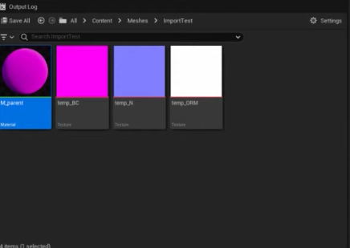

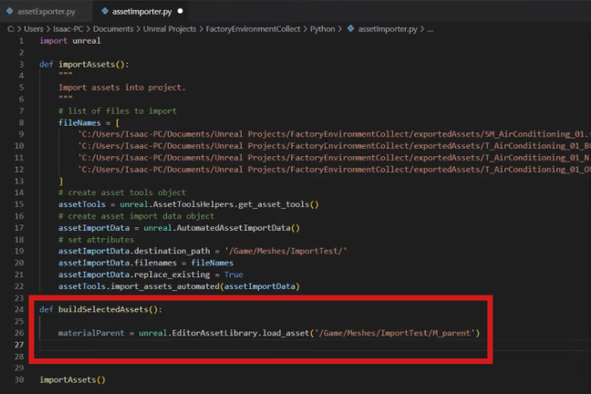

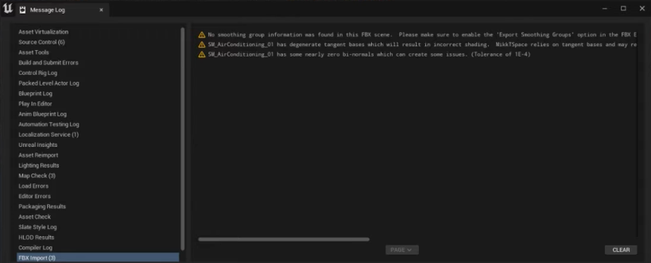

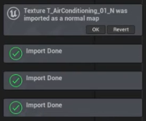

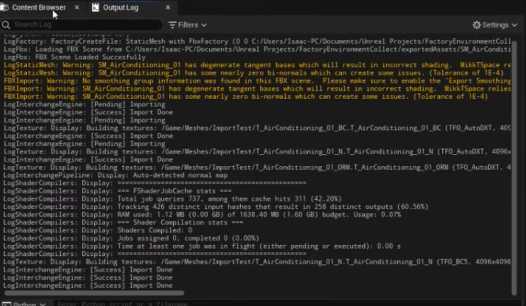

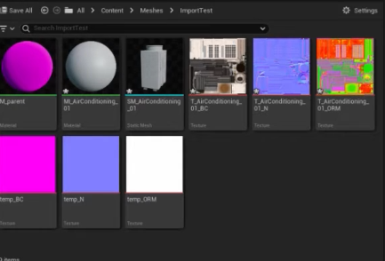

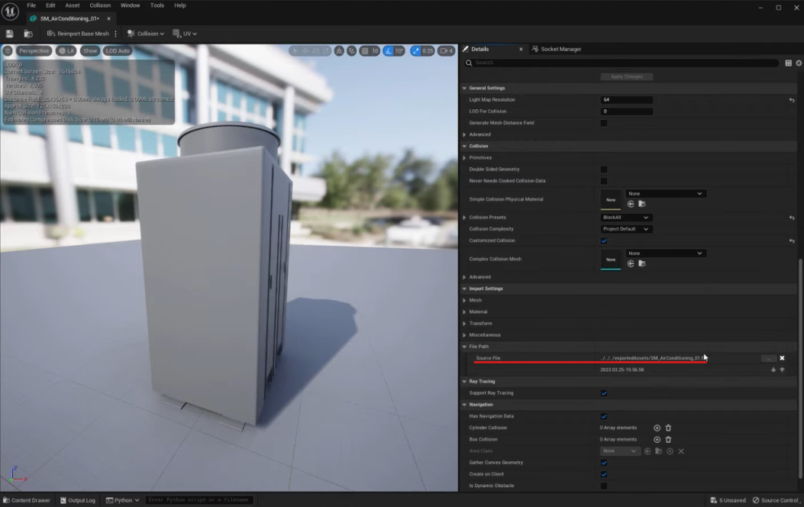

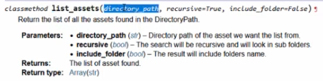

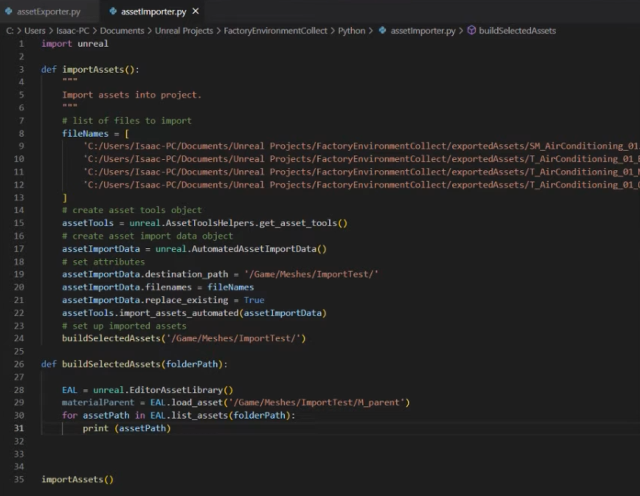

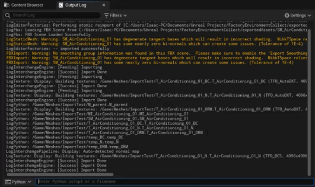

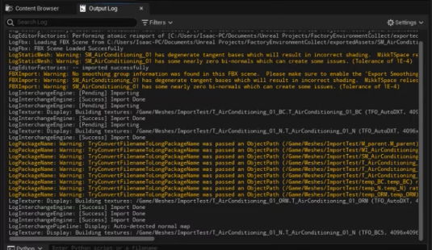

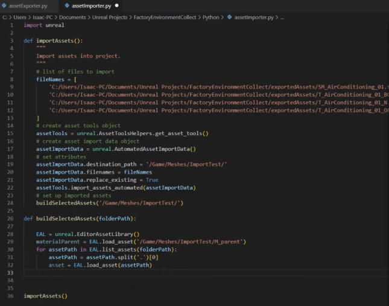

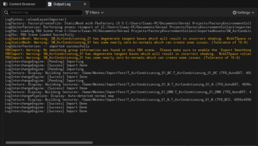

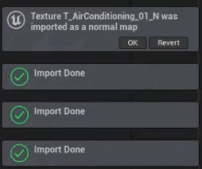

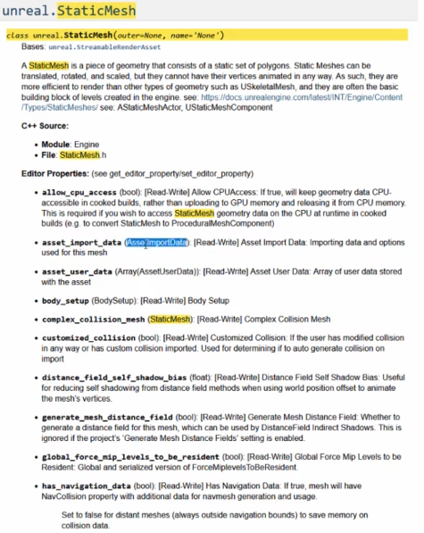

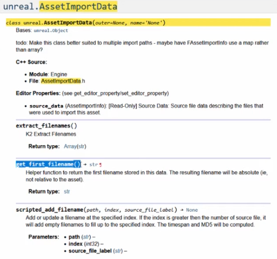

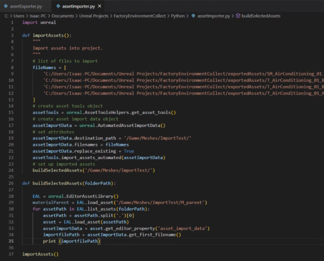

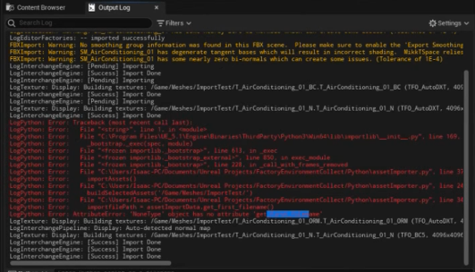

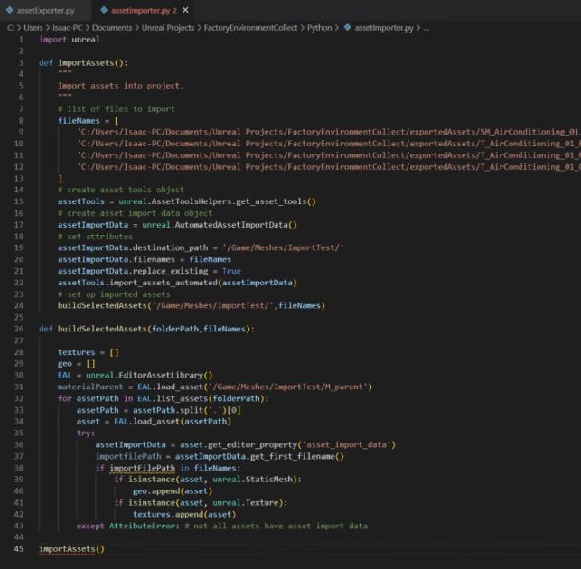

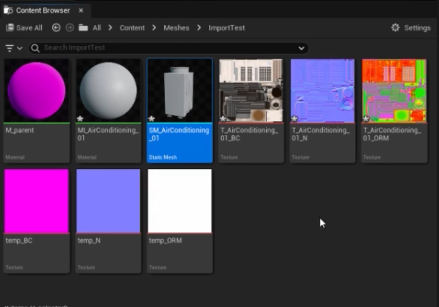

## Source note

[Original Asset Setup 01.md](file:///C:/Users/antho/OneDrive/Desktop/Notes/anthony/personal/Duke%20Tech%20Art%20Course%20Notes/18%20Oster%20Asset%20Setup%20UE%20Python%20API/Asset%20Setup%2001.md)
