# Asset Setup 02 — inspect material slots and create instances

The second lesson moves from identifying imported assets to creating a material instance for each intended mesh slot. Its strongest teaching contribution is the relationship between **slot metadata, material objects, asset classes and factories**.

The demonstration removes an imported default material so its name can be reused. Preserve that as a description of the tutorial’s approach, while separating it from a general recommendation for a reusable tool.

## Read the static mesh’s material slots

`StaticMesh.static_materials` is an array of `StaticMaterial` structures. A structure exposes named properties; it is **not a Python dictionary**, even if its printed representation resembles one.

| Value | Meaning |
| --- | --- |
| Array index | The numeric slot used by `StaticMesh.set_material` |
| `material_slot_name` | The slot’s semantic name |
| `material_interface` | The material object currently assigned to that slot |
| `imported_material_slot_name` | Imported slot metadata; retain it when discussing import/reimport behavior |
| `uv_channel_data` | Texture-streaming-related UV data, outside this lesson’s editing task |

The slot name and the assigned asset’s name are related in the example, but they are not interchangeable identifiers. Multiple slots or meshes may refer to the same material asset. A slot may also lack a usable material reference.

An FBX import can derive slot/material information from the DCC scene. The exact generated assets and names depend on the importer and its options; do not promise that every DCC material creates a new Unreal material on every import.

## Iterate with an explicit index

Use `enumerate` to keep the slot index attached to each record. The original code calls `.index(staticMaterial)` during iteration, which repeatedly searches the array and can select the first equal record when duplicate values occur.

This is a read-only inspection function for Unreal. It does not reassign or delete a material.

```python
import unreal

def describe_material_slots(mesh):
    if not isinstance(mesh, unreal.StaticMesh):
        raise TypeError("Expected a StaticMesh asset")

    slots = mesh.get_editor_property("static_materials")
    for index, slot in enumerate(slots):
        material = slot.get_editor_property("material_interface")
        name = str(slot.get_editor_property("material_slot_name"))
        path = material.get_path_name() if material else "<unassigned>"
        print(index, name, path)
```

Use this information to prepare a change plan: mesh identity, slot index/name, current material, proposed instance and reason for the replacement.

## MaterialInterface explains the accepted types

`MaterialInterface` is a common base used by materials and material instances. A slot can therefore refer to a base material or an instance through the same interface. This is why the assignment API accepts a `MaterialInterface`, rather than only a concrete `Material` asset.

For the persistent editor asset created in this lesson, use `MaterialInstanceConstant`. A dynamic material instance serves a different use case; it is not a drop-in substitute for creating the same saved Content Browser asset with this factory.

## Understand the deletion step before adopting it

The tutorial retrieves the assigned material’s path and passes it to `EditorAssetLibrary.delete_asset`, then creates a replacement using the slot name. This illustrates asset deletion, but the returned reference does not prove that the material is disposable or exclusive to this import.


The current API describes this as force deletion: references elsewhere are not checked, and undo history may be affected. A Boolean result must be inspected. The lesson’s failed deletion and later clean retry do not establish a general explanation such as permissions or package corruption. [Epic deletion reference](https://dev.epicgames.com/documentation/en-us/unreal-engine/python-api/class/EditorAssetLibrary?application_version=5.7#unreal.EditorAssetLibrary.delete_asset)

**Recommended teaching adaptation:** create a distinct material instance, validate it, and reassign only the reviewed slots. Make removal of old assets a separate decision based on ownership and remaining references. If import settings can avoid generating unwanted materials in the first place, evaluate that for the chosen importer rather than deleting every discovered material afterward.

This also changes failure behavior: deleting first can remove a useful assignment before instance creation or texture setup succeeds. A sequence of successful calls is not an automatic transaction or rollback mechanism.

## Create the material-instance asset

Get the Asset Tools service through `unreal.AssetToolsHelpers.get_asset_tools()`. Its `create_asset` method needs the new name, destination folder, class and a factory object.


The class and factory have different roles:

| Argument | Example | Role |
| --- | --- | --- |
| `asset_name` | `MI_AirConditioning_01_Body` | Name of the new asset |
| `package_path` | `/Game/Meshes/ImportTest` | Destination content folder |
| `asset_class` | `unreal.MaterialInstanceConstant` | Type to create; pass the class |
| `factory` | `unreal.MaterialInstanceConstantFactoryNew()` | Creator object; construct an instance |

The lesson deliberately encounters both mistakes: passing the factory class without constructing it, and choosing a class the factory does not support. Refine those trial-and-error moments into a clear rule: **match the asset class to the factory, and pass an instantiated factory**.

This Unreal-editor example creates an unsaved instance when called. It does not set a parent, assign textures, modify a mesh or delete an existing asset.

```python
import unreal

def create_empty_instance(asset_name, destination):
    target = f"{destination.rstrip('/')}/{asset_name}"
    if unreal.EditorAssetLibrary.does_asset_exist(target):
        raise ValueError(f"Destination already exists: {target}")

    instance = unreal.AssetToolsHelpers.get_asset_tools().create_asset(
        asset_name,
        destination,
        unreal.MaterialInstanceConstant,
        unreal.MaterialInstanceConstantFactoryNew(),
    )
    if not isinstance(instance, unreal.MaterialInstanceConstant):
        raise RuntimeError(f"Material-instance creation failed: {target}")
    return instance
```

The destination and asset name still require project-specific validation. The existence check is a clear conflict policy for a teaching example, not a guarantee against concurrent changes.

## Naming and repeated runs

The source reuses `material_slot_name` as the new asset name. In a controlled example that is convenient; across a collection, names such as `Body` can recur in several meshes and collide in one destination folder. Convert Unreal `Name` values to a string when constructing a Python naming rule, and include enough identity to express the intended ownership.

Decide whether a repeated run should reuse a compatible instance, update a known generated instance, choose a new name or stop with a conflict. A unique name prevents overwriting, but can create duplicates every run; it does not make the operation idempotent.

**Course application:** show the slot record beside the asset-creation call. Students can trace where the name, target slot and type come from without relying on a live destructive demonstration.

**Review question:** two imported meshes reference the same default material. What could happen if the first loop iteration deletes it before the second mesh is processed?

## References

- [Oster: Asset Setup with the Unreal Python API](https://dev.epicgames.com/community/learning/tutorials/xrnE/unreal-engine-asset-setup-with-the-unreal-python-api)
- [Epic StaticMaterial reference, UE 5.7](https://dev.epicgames.com/documentation/en-us/unreal-engine/python-api/class/StaticMaterial?application_version=5.7)
- [Epic AssetTools reference, UE 5.7](https://dev.epicgames.com/documentation/en-us/unreal-engine/python-api/class/AssetTools?application_version=5.7)
- Class/factory signatures were also checked against the local project-generated stub. No asset creation or deletion was executed for these notes.


## Additional original captures

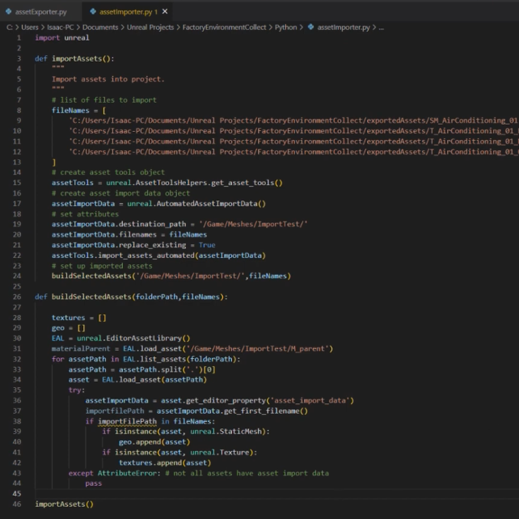

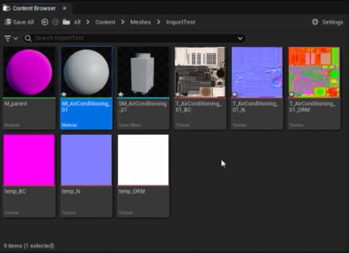

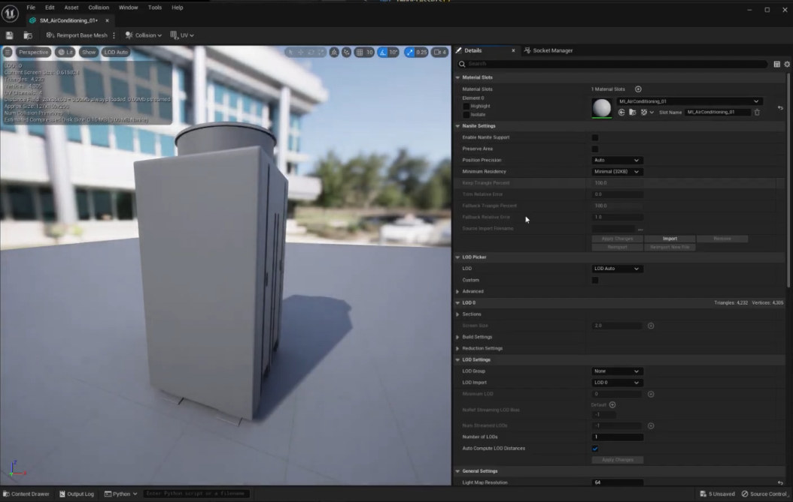

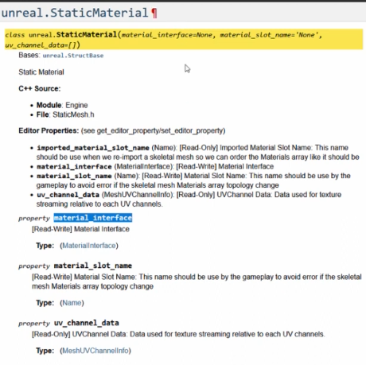

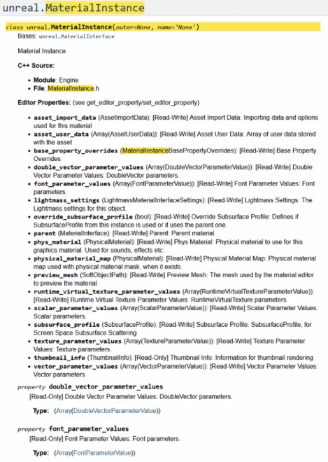

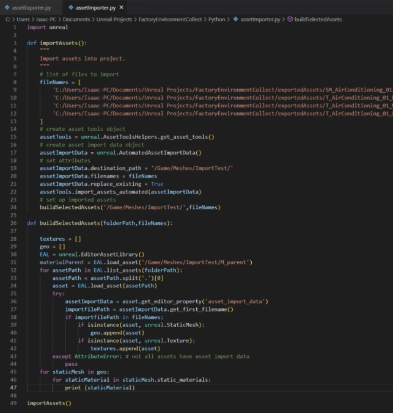

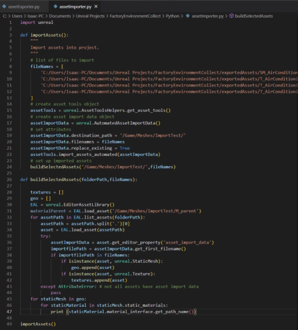

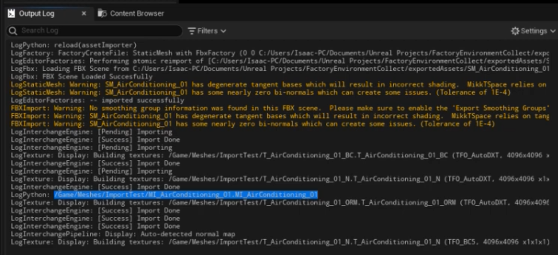

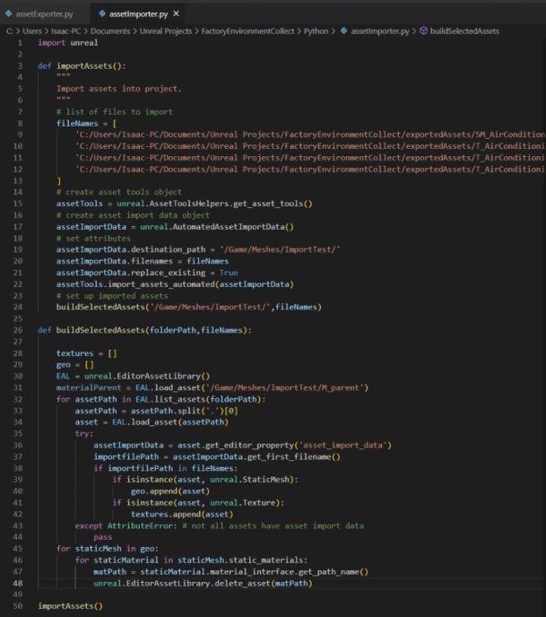

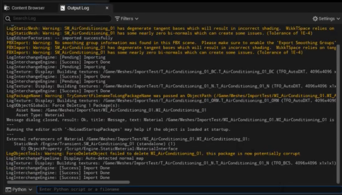

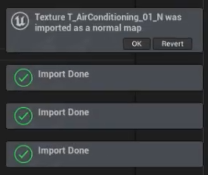

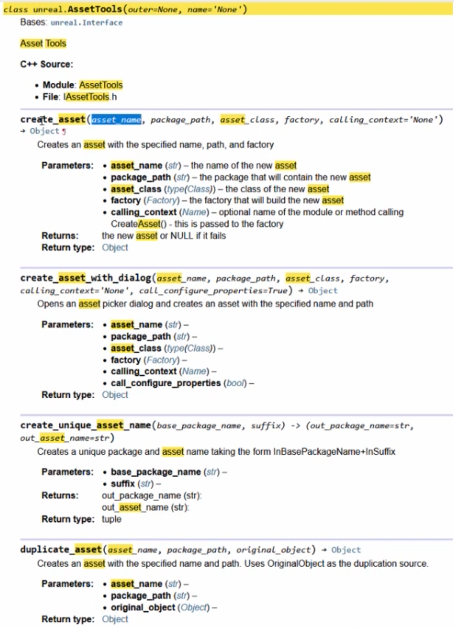

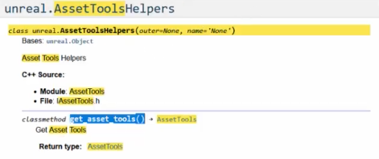

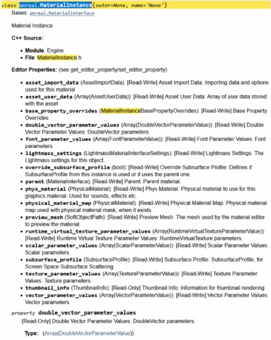

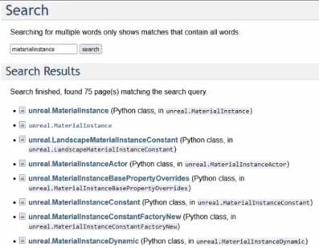

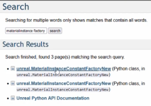

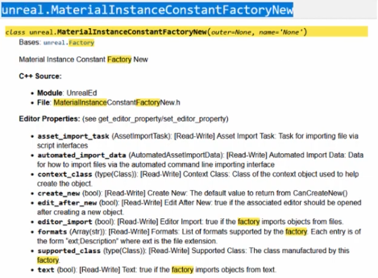

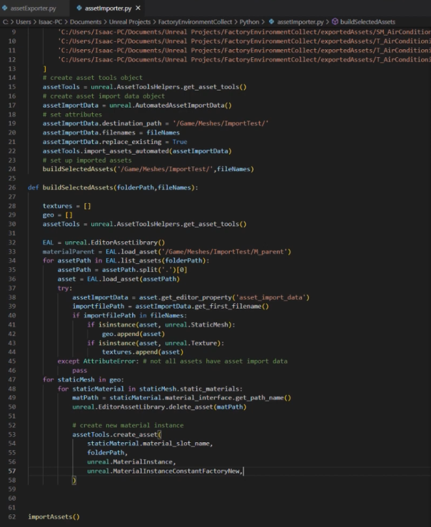

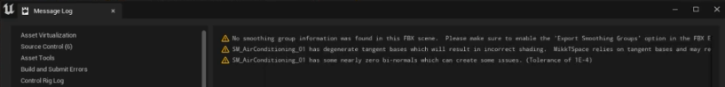

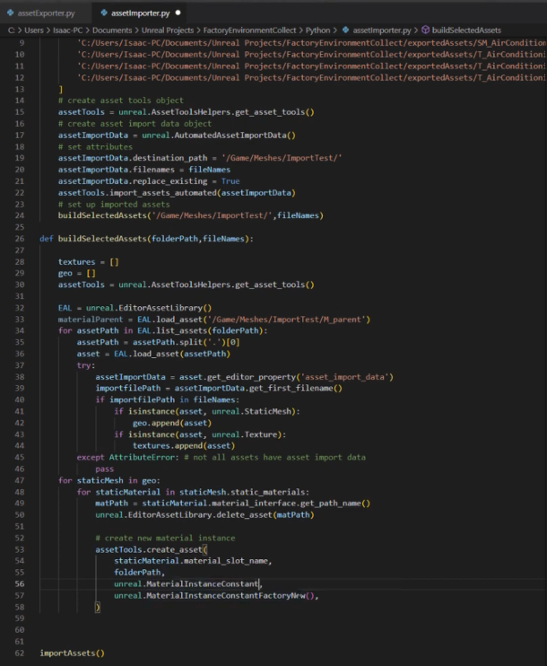

## Source note

[Original Asset Setup 02.md](file:///C:/Users/antho/OneDrive/Desktop/Notes/anthony/personal/Duke%20Tech%20Art%20Course%20Notes/18%20Oster%20Asset%20Setup%20UE%20Python%20API/Asset%20Setup%2002.md)
