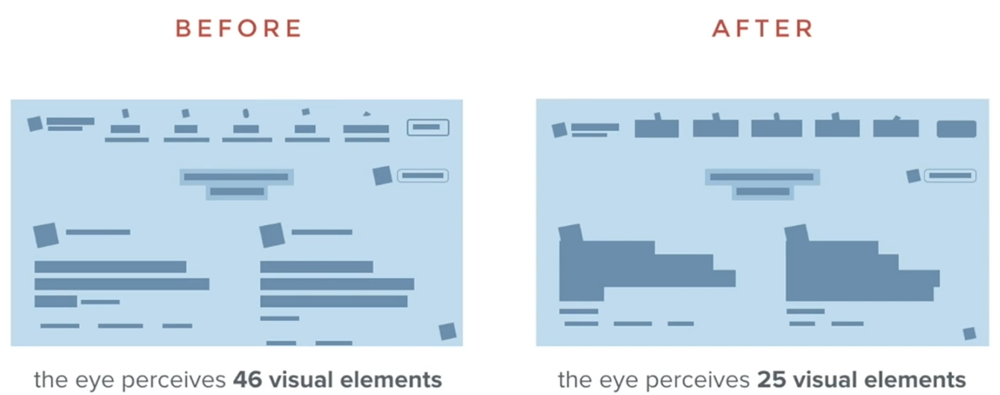

# 09 · Balance Creates Visual Order

Refined 15 October 2026 from the supplied Joe Natoli course notes. Original wording and captures remain preserved.

## Core principle

Balance distributes visual weight. Negative space and alignment can make relationships clear without symmetrical composition.

## Application to game tools

Separate task inputs, review information and actions while retaining a clear reading route.

## Assessment and qualification

A balanced appearance alone does not prove efficient operation.

## Try it

Which group looks important, and is that the intended group?

Source: [09 Balance Creates Visual Order.md](file:///C:/Users/antho/OneDrive/Desktop/Notes/anthony/personal/Duke%20Tech%20Art%20Course%20Notes/17%20UI%20UX%20Design%20Principles/02%20Organizing%20Visual%20Information/09%20Balance%20Creates%20Visual%20Order.md)

## Study detail and teaching translation

- Visual weight comes from more than physical size: density, contrast, isolation and surrounding space affect the composition.

- Balance can be symmetrical or asymmetrical. The objective is a readable relationship between regions, not equal quantities on both sides.

- Teaching adaptation: compare the weight of inputs, review information and actions. A large empty table may be acceptable as a stable work area, but it should not obscure the next available action.

## Original captures

