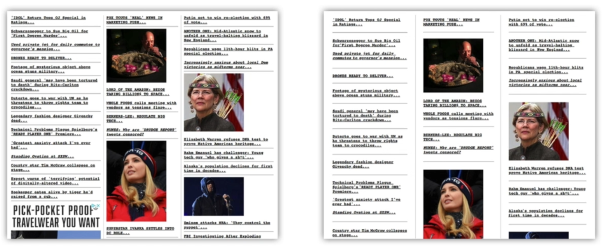
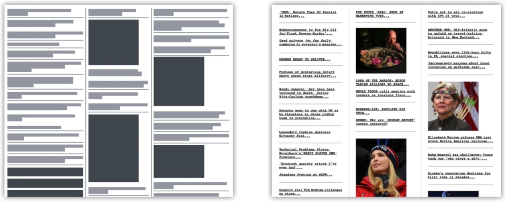
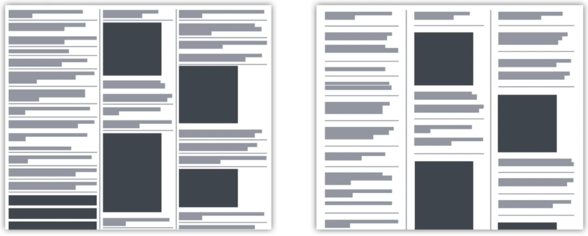
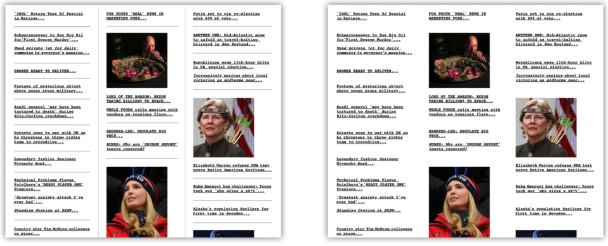
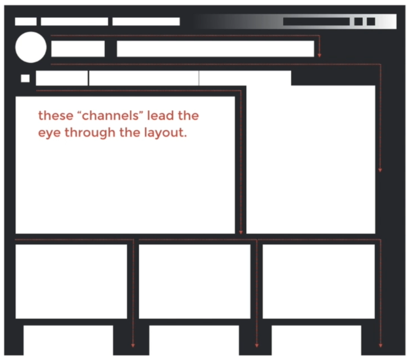

# 10 · Case Studies - Improving Balance in the User Interface

Refined 15 October 2026 from the supplied Joe Natoli course notes. Original wording and captures remain preserved.

## Core principle

Targeted changes to column widths, gutters and padding can clarify an existing interface.

## Application to game tools

Improve one crowded tool group before proposing a complete visual redesign.

## Assessment and qualification

The captured before/after is a design demonstration, not a measured user-study result.

## Try it

Can a new user correctly group the same controls after the change?

Source: [10 Case Studies - Improving Balance in the User Interface.md](file:///C:/Users/antho/OneDrive/Desktop/Notes/anthony/personal/Duke%20Tech%20Art%20Course%20Notes/17%20UI%20UX%20Design%20Principles/02%20Organizing%20Visual%20Information/10%20Case%20Studies%20-%20Improving%20Balance%20in%20the%20User%20Interface.md)

## Study detail and teaching translation

- Inspect the existing structure before redesigning it: unequal gutters, cramped margins and weak separation can make otherwise sensible groups difficult to read.

- Change a small set of relationships, then compare the result using the same content. This makes the reason for the improvement easier to explain.

- Teaching adaptation: use matched material-preview captures. Distinguish a design demonstration from a measured claim about faster task completion.

## Original captures

