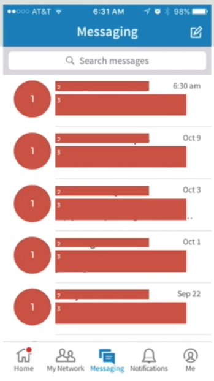
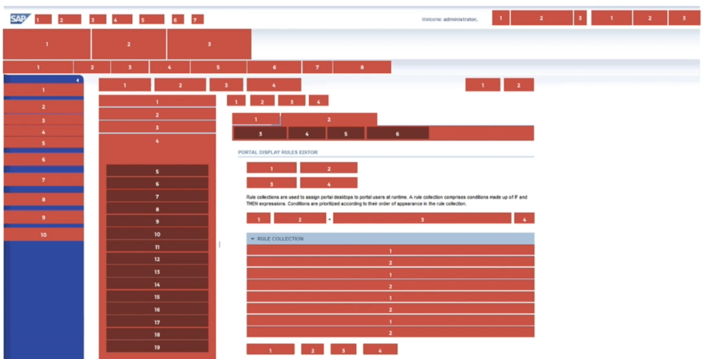

# 11 · Rhythm - Establishing and Reinforcing Comprehension

Refined 15 October 2026 from the supplied Joe Natoli course notes. Original wording and captures remain preserved.

## Core principle

Rhythm is the predictable recurrence of related elements and the intervals between them.

## Application to game tools

Repeat asset-row order, label spacing and state treatment so a user can scan successive items.

## Assessment and qualification

A repeated pattern can also repeat a poor choice; consistency must serve the task.

## Try it

Which detail should remain stable from one row to the next?

Source: [11 Rhythm - Establishing and Reinforcing Comprehension.md](file:///C:/Users/antho/OneDrive/Desktop/Notes/anthony/personal/Duke%20Tech%20Art%20Course%20Notes/17%20UI%20UX%20Design%20Principles/02%20Organizing%20Visual%20Information/11%20Rhythm%20-%20Establishing%20and%20Reinforcing%20Comprehension.md)

## Study detail and teaching translation

- Repetition creates an expectation: users learn where a label, value, status or action will appear in the next instance.

- Intervals participate in the pattern. Consistent spacing within a group and between repeated groups can make the sequence easier to scan.

- Teaching adaptation: keep asset identity, before, after and status in a predictable order. Reserve a deliberate pattern break for an exception that deserves attention.

## Original captures

