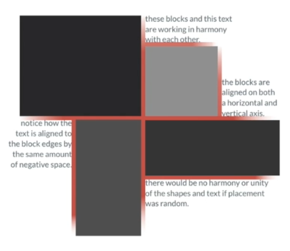
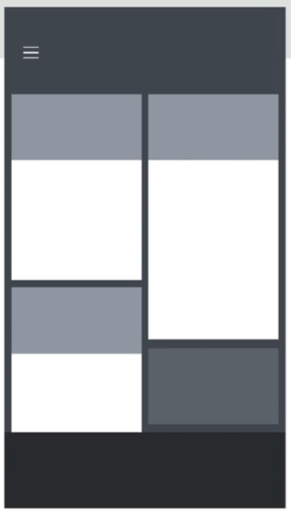
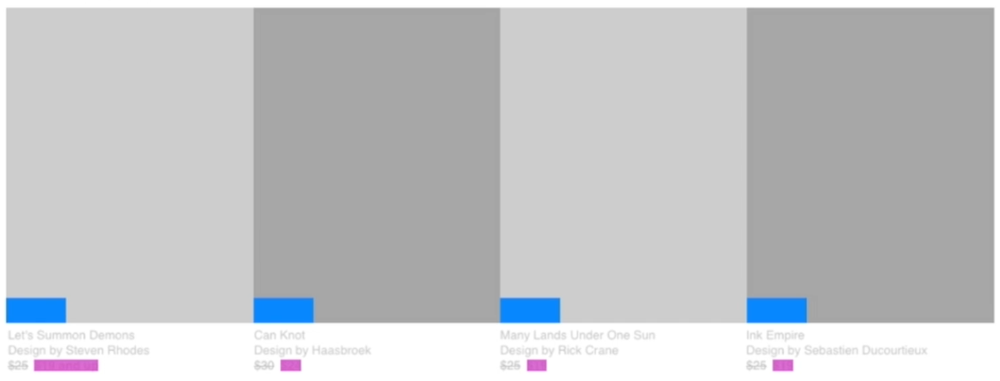

# 12 · Harmony - Shaping the Parts into a Whole

Refined 15 October 2026 from the supplied Joe Natoli course notes. Original wording and captures remain preserved.

## Core principle

Harmony comes from related visual treatments that make separate elements read as a coherent whole.

## Application to game tools

Use shared spacing, type roles, icon treatment and semantic state colors across related tools.

## Assessment and qualification

A visual echo communicates similarity only when the underlying meaning is also consistent.

## Try it

Do two similar-looking controls behave similarly?

Source: [12 Harmony - Shaping the Parts into a Whole.md](file:///C:/Users/antho/OneDrive/Desktop/Notes/anthony/personal/Duke%20Tech%20Art%20Course%20Notes/17%20UI%20UX%20Design%20Principles/02%20Organizing%20Visual%20Information/12%20Harmony%20-%20Shaping%20the%20Parts%20into%20a%20Whole.md)

## Study detail and teaching translation

- Harmony means the parts support a coherent whole. Related shapes, typography, spacing and color roles can make separate regions feel connected.

- Similarity should correspond to meaning. Reusing one treatment for unrelated states creates visual consistency but semantic confusion.

- Teaching adaptation: use shared form patterns and state labels across Material Setup and VFX Placement. Preserve host-specific differences that serve a real interaction need.

## Original captures

