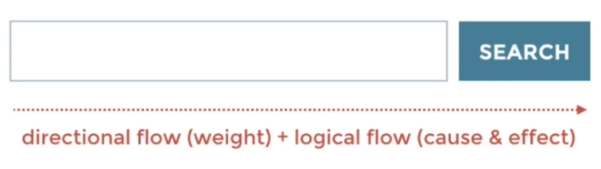

# 13 · Using Harmony to Create Directional Flow

Refined 15 October 2026 from the supplied Joe Natoli course notes. Original wording and captures remain preserved.

## Core principle

Alignment, spacing and emphasis can suggest a reading and action sequence.

## Application to game tools

Arrange source, destination, preview and commit in a route that matches the workflow.

## Assessment and qualification

Left-to-right examples reflect a reading context; localization and task structure can require a different route.

## Try it

Where does the eye go after the most prominent element?

Source: [13 Using Harmony to Create Directional Flow.md](file:///C:/Users/antho/OneDrive/Desktop/Notes/anthony/personal/Duke%20Tech%20Art%20Course%20Notes/17%20UI%20UX%20Design%20Principles/02%20Organizing%20Visual%20Information/13%20Using%20Harmony%20to%20Create%20Directional%20Flow.md)

## Study detail and teaching translation

- Directional flow emerges from alignment, grouping, repetition and changes in emphasis; it is not limited to adding arrows.

- A strong starting point should lead toward the next relevant information. Multiple unrelated focal points can interrupt the intended sequence.

- Teaching adaptation: organize source inputs, scope, reviewed consequence and Apply in the order the artist needs them. Test the reading route rather than assuming a universal scanning pattern.

## Original captures

