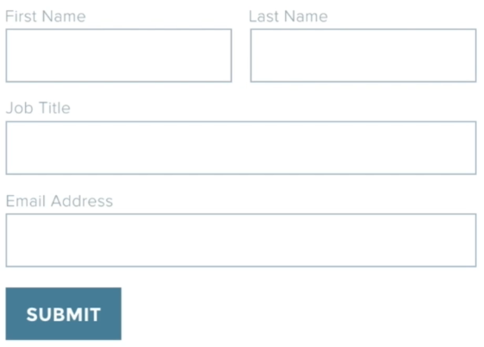
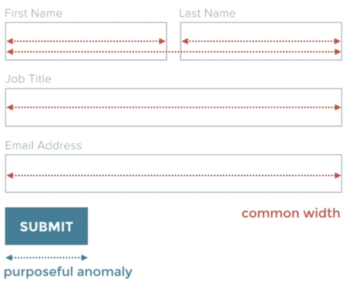
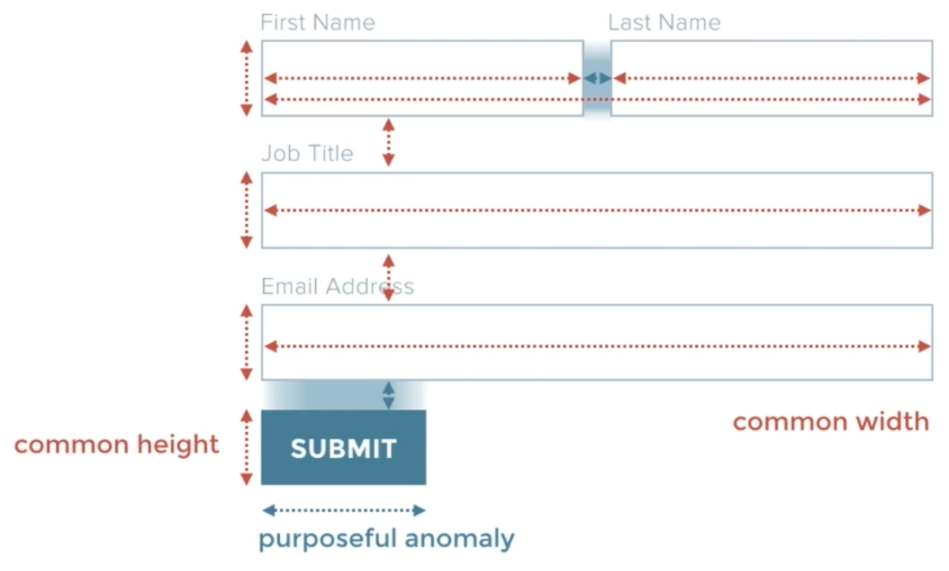
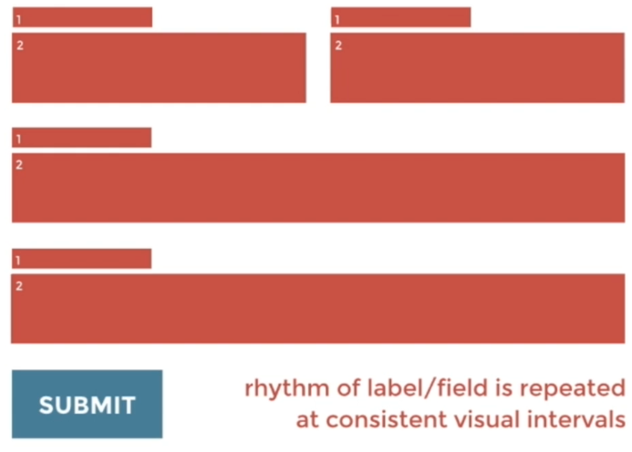
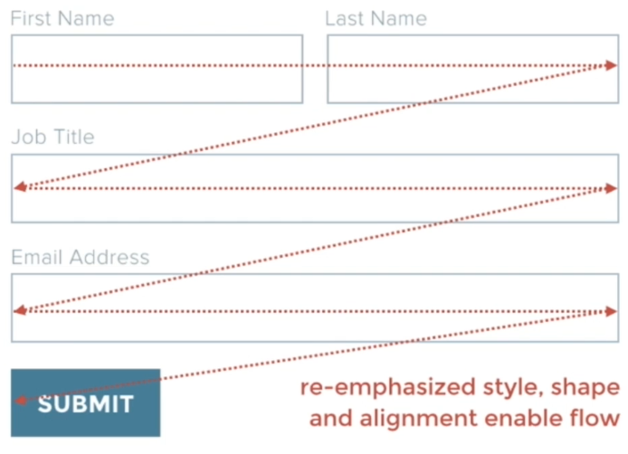

# 14 · Case Study - Using Harmony for Better Form Design

Refined 15 October 2026 from the supplied Joe Natoli course notes. Original wording and captures remain preserved.

## Core principle

Repeated field dimensions and spacing establish a pattern; a deliberate difference can distinguish the action.

## Application to game tools

Use form layouts and recognizable buttons rather than hand-positioned labels and decorative action text.

## Assessment and qualification

A shorter button is not inherently more usable. Full-width buttons can be appropriate in narrow tools and are explicitly used in the GOLF+ playbook.

## Try it

Is the action distinct while remaining consistent with the host application?

Source: [14 Case Study - Using Harmony for Better Form Design.md](file:///C:/Users/antho/OneDrive/Desktop/Notes/anthony/personal/Duke%20Tech%20Art%20Course%20Notes/17%20UI%20UX%20Design%20Principles/02%20Organizing%20Visual%20Information/14%20Case%20Study%20-%20Using%20Harmony%20for%20Better%20Form%20Design.md)

## Study detail and teaching translation

- Repeated field treatment helps the user recognize a form as a sequence of related decisions. Consistent labels, widths and gaps reduce unnecessary variation.

- The action should be recognizable as a control and distinct from descriptive headings. A purposeful change in treatment can mark the transition from entering information to acting.

- Teaching adaptation: use Qt form layouts and explicit button labels. The course example’s narrower button is one solution; a full-width primary action can also be appropriate in a narrow game-tool panel.

## Original captures

