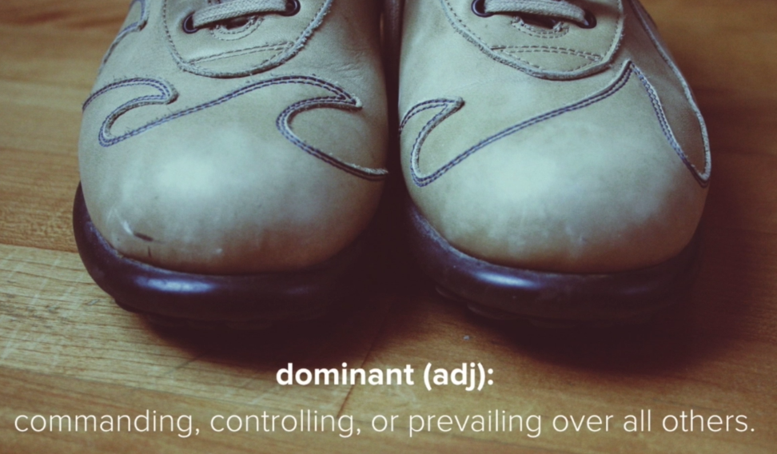
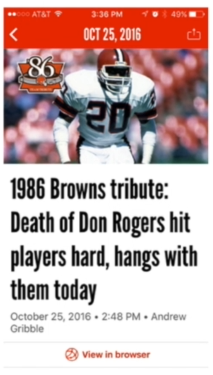

# 15 · Dominance - Directing (and Maintaining) User Focus

Refined 15 October 2026 from the supplied Joe Natoli course notes. Original wording and captures remain preserved.

## Core principle

Dominance gives the viewer an entry point and suggests relative importance through size, contrast, position and surrounding space.

## Application to game tools

Emphasize the current decision. Before a valid preview, the next action is Preview rather than an unavailable Apply.

## Assessment and qualification

No single visual feature determines attention in every situation; task and familiarity also matter.

## Try it

Does the strongest emphasis correspond to the current state?

Source: [15 Dominance - Directing (and Maintaining) User Focus.md](file:///C:/Users/antho/OneDrive/Desktop/Notes/anthony/personal/Duke%20Tech%20Art%20Course%20Notes/17%20UI%20UX%20Design%20Principles/02%20Organizing%20Visual%20Information/15%20Dominance%20-%20Directing%20%28and%20Maintaining%29%20User%20Focus.md)

## Study detail and teaching translation

- Dominance establishes a focal point and an order of importance. Consider what wins attention before reading every label.

- Size, contrast, position and empty space work together; the strongest feature should correspond to a meaningful priority.

- Teaching adaptation: the priority changes with state. Preview leads before a plan exists; Apply leads after review and required acknowledgment; the result deserves attention after completion.

## Original captures

