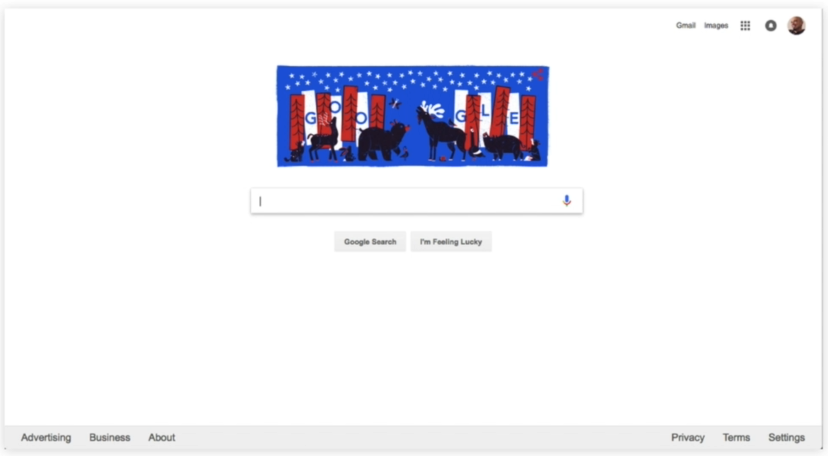
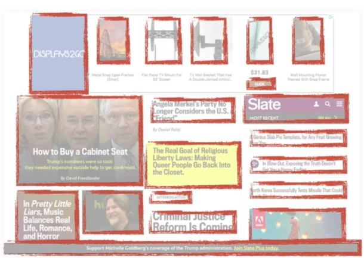

# 17 · Creating Dominance with Size, Negative Space and Contrast

Refined 15 October 2026 from the supplied Joe Natoli course notes. Original wording and captures remain preserved.

## Core principle

Size, negative space and contrast interact to establish emphasis. A small isolated element can be more noticeable than a large busy one.

## Application to game tools

Use one intentional accent for an available task action; let decorative headings remain secondary.

## Assessment and qualification

Replace “contrast trumps size every time” with a contextual design hypothesis.

## Try it

Would the action still be apparent without its color?

Source: [17 Creating Dominance with Size, Negative Space and Contrast.md](file:///C:/Users/antho/OneDrive/Desktop/Notes/anthony/personal/Duke%20Tech%20Art%20Course%20Notes/17%20UI%20UX%20Design%20Principles/02%20Organizing%20Visual%20Information/17%20Creating%20Dominance%20with%20Size%2C%20Negative%20Space%20and%20Contrast.md)

## Study detail and teaching translation

- Compare an element with its surroundings. Isolation and local contrast can give a small item considerable emphasis; large size alone does not establish priority.

- Negative space is active structure: it separates unrelated items and gives important regions room to be perceived.

- Teaching adaptation: use the same screenshot in original, grayscale and coarse squint views. Inspect whether the intended task action remains prominent without relying entirely on hue.

## Original captures

