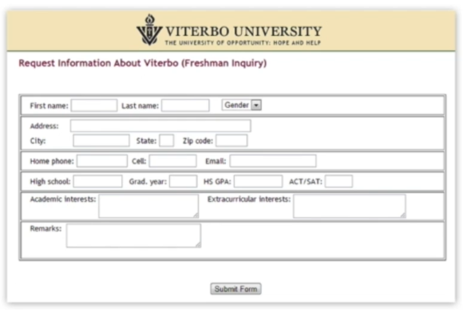
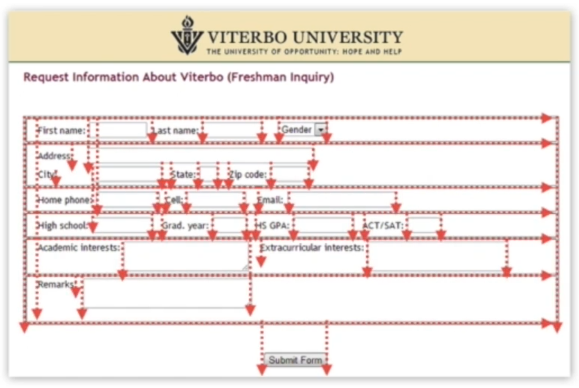
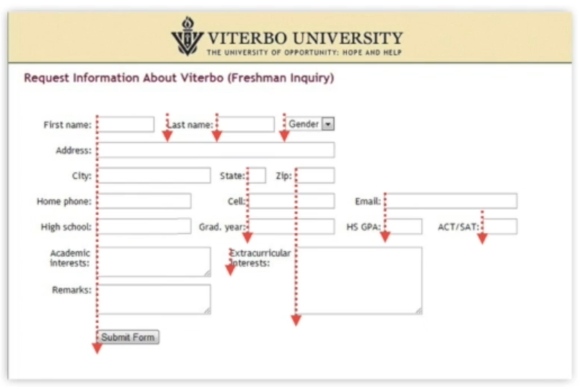
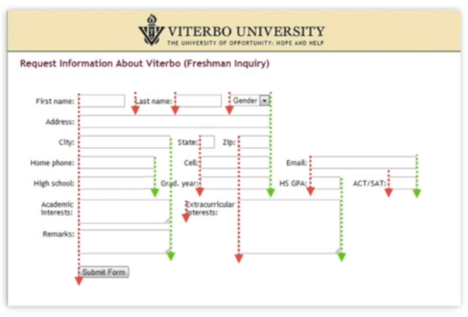
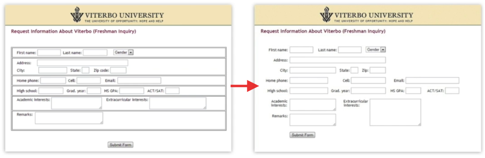

# 18 · Alignment - Leading the Eye Across the Screen

Refined 15 October 2026 from the supplied Joe Natoli course notes. Original wording and captures remain preserved.

## Core principle

Consistent alignment reduces unnecessary visual paths and helps associate labels with fields.

## Application to game tools

Use shared label edges, logical field order and host layout managers; test the smallest supported window.

## Assessment and qualification

Do not repeat unquantified dramatic performance gains. Borders can be necessary to identify controls; removing every boundary is not the goal.

## Try it

Which edge can align without implying an incorrect relationship?

Source: [18 Alignment - Leading the Eye Across the Screen.md](file:///C:/Users/antho/OneDrive/Desktop/Notes/anthony/personal/Duke%20Tech%20Art%20Course%20Notes/17%20UI%20UX%20Design%20Principles/02%20Organizing%20Visual%20Information/18%20Alignment%20-%20Leading%20the%20Eye%20Across%20the%20Screen.md)

## Study detail and teaching translation

- Alignment creates shared reference lines. Consistent edges help associate labels, fields, rows and groups without adding a rule around every region.

- Simplify a screen into shapes to inspect alignment independently of its detailed content. Restore text afterward to check actual readability and meaning.

- Teaching adaptation: let layout managers express relationships, then test window resizing. Keep borders where they communicate a necessary control boundary or state.

## Original captures

