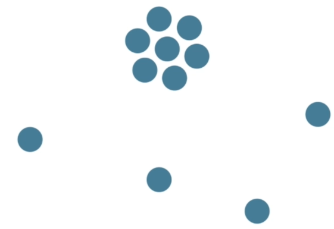
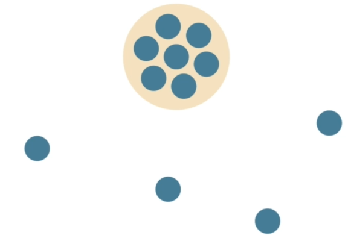

# 20 · Proximity - Showing and Communicating Visual Relationships

Refined 15 October 2026 from the supplied Joe Natoli course notes. Original wording and captures remain preserved.

## Core principle

Closer items tend to be perceived as related. Larger gaps can separate different tasks or information groups.

## Application to game tools

Keep a label, its input and its validation message together; separate global actions from per-item controls.

## Assessment and qualification

Proximity is a strong cue, not a universal winner over every other cue.

## Try it

Does the nearest action affect that group or something elsewhere?

Source: [20 Proximity - Showing and Communicating Visual Relationships.md](file:///C:/Users/antho/OneDrive/Desktop/Notes/anthony/personal/Duke%20Tech%20Art%20Course%20Notes/17%20UI%20UX%20Design%20Principles/02%20Organizing%20Visual%20Information/20%20Proximity%20-%20Showing%20and%20Communicating%20Visual%20Relationships.md)

## Study detail and teaching translation

- Distance suggests association: nearby items tend to read as a group, and larger gaps can signal a transition to another group.

- Apply proximity to the relationship being communicated. A validation message should be clearly associated with the affected field; a global action should not appear to affect only its nearest row.

- Teaching adaptation: compare within-group gaps with between-group gaps. Use alignment and labels to reinforce relationships where proximity alone is ambiguous.

## Original captures

