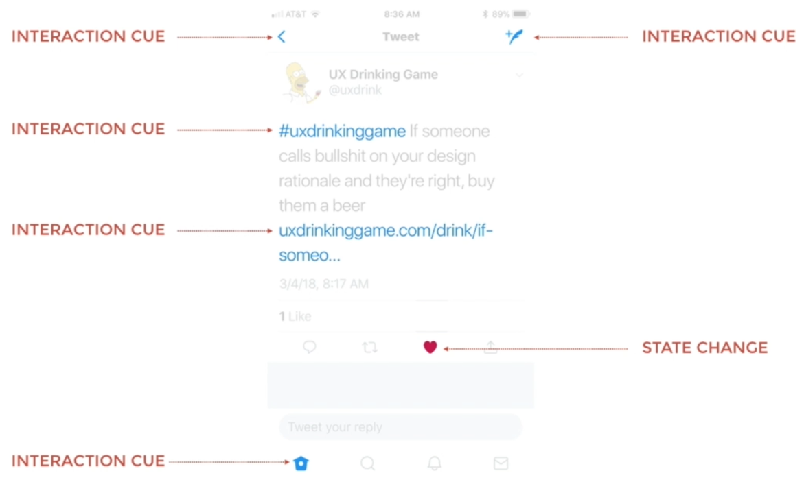
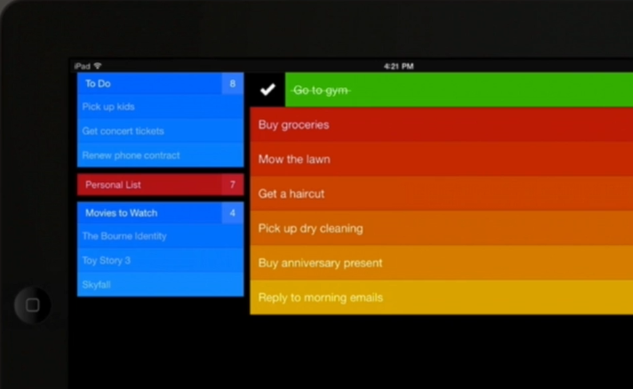

# 24 · How Color Influences Interaction

Refined 15 October 2026 from the supplied Joe Natoli course notes. Original wording and captures remain preserved.

## Core principle

Consistent color roles support continuity. Meaning must remain understandable without color alone.

## Application to game tools

Use labels for warning, blocked, complete and selected states; retain focus and shape cues in both light and dark hosts.

## Assessment and qualification

Do not mandate light backgrounds for all long sessions or repeat the transcript’s physiology explanation. Grayscale is not a simulation of all color-vision differences.

## Try it

Can you understand the status when the hue cue is unavailable?

Source: [24 How Color Influences Interaction.md](file:///C:/Users/antho/OneDrive/Desktop/Notes/anthony/personal/Duke%20Tech%20Art%20Course%20Notes/17%20UI%20UX%20Design%20Principles/03%20Using%20Color%20and%20Contrast%20Appropriately/24%20How%20Color%20Influences%20Interaction.md)

## Study detail and teaching translation

- Once an interface establishes a color cue, consistent reuse helps users predict its meaning. Breaking the cue can create false expectations.

- Evaluate color on the actual background and within the host application. Saturation and competing accents can change the apparent hierarchy.

- Teaching adaptation: a dark editor tool can be appropriate, but its labels and states still need inspection. Test meaning without hue and use color-vision/accessibility checks separately.

## Original captures

