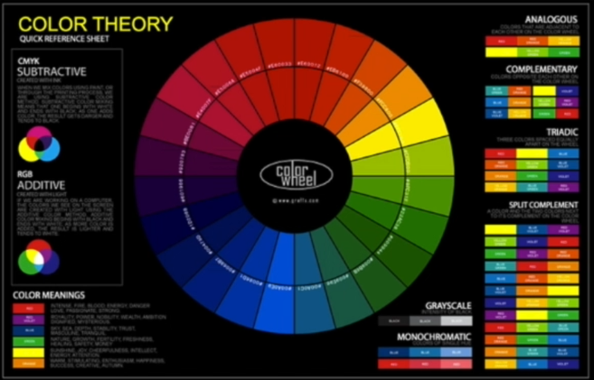

# 25 · A Word on Color Theory - and Using Color Correctly

Refined 15 October 2026 from the supplied Joe Natoli course notes. Original wording and captures remain preserved.

## Core principle

Evaluate color by its function: hierarchy, consistency, context and accessible communication.

## Application to game tools

Use palette tools for exploration, then assign roles and validate actual foreground/background pairs.

## Assessment and qualification

The lecturer’s dismissal of color theory is opinion. Art fundamentals are useful here and are explicitly retained in this adaptation.

## Try it

What is the purpose of each accent, and does that purpose stay consistent?

Source: [25 A Word on Color Theory - and Using Color Correctly.md](file:///C:/Users/antho/OneDrive/Desktop/Notes/anthony/personal/Duke%20Tech%20Art%20Course%20Notes/17%20UI%20UX%20Design%20Principles/03%20Using%20Color%20and%20Contrast%20Appropriately/25%20A%20Word%20on%20Color%20Theory%20-%20and%20Using%20Color%20Correctly.md)

## Study detail and teaching translation

- The source favors practical communication over elaborate color-theory exercises. Retain that practical focus without dismissing the value of art fundamentals.

- A palette does not specify which color belongs to which role. Establish surfaces, text, emphasis and semantic states, then test their actual combinations.

- Teaching adaptation: explore options with Coolors, document the chosen roles in the style sheet, and check real text/background pairs rather than judging isolated swatches.

## Original captures

