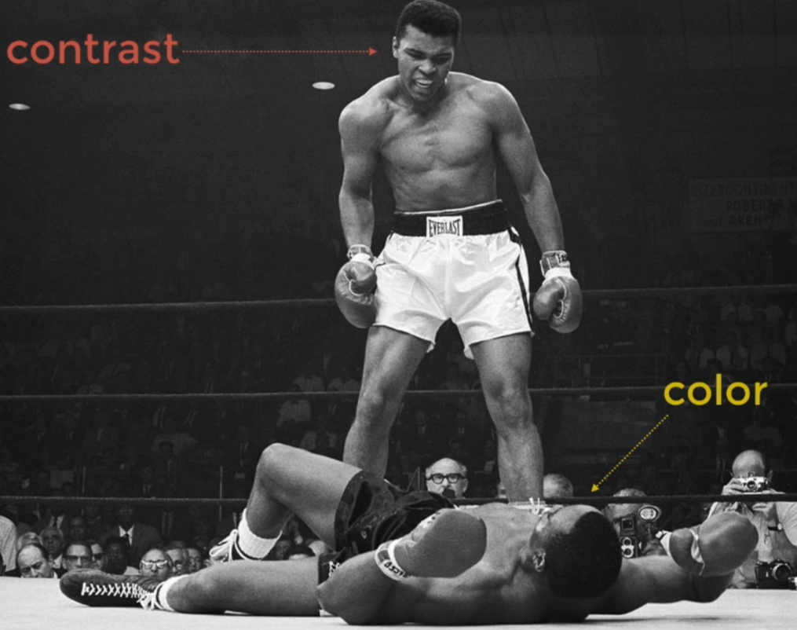

# 30 · The Power of Contrast

Refined 15 October 2026 from the supplied Joe Natoli course notes. Original wording and captures remain preserved.

## Core principle

Contrast means perceivable difference and helps distinguish boundaries and information.

## Application to game tools

Separate light/dark value, hue, scale, shape and spacing as different sources of visual distinction.

## Assessment and qualification

Omit the boxing anecdote and the source’s inaccurate attribution. Do not translate a metaphor into a guarantee about attention.

## Try it

Which difference is doing the useful work in this interface?

Source: [30 The Power of Contrast.md](file:///C:/Users/antho/OneDrive/Desktop/Notes/anthony/personal/Duke%20Tech%20Art%20Course%20Notes/17%20UI%20UX%20Design%20Principles/03%20Using%20Color%20and%20Contrast%20Appropriately/30%20The%20Power%20of%20Contrast.md)

## Study detail and teaching translation

- Contrast is a relationship between elements or between an element and its surroundings. It can distinguish information, controls and boundaries.

- Light/dark difference, hue, size, shape and spacing contribute different cues. Avoid reducing every contrast problem to selecting a brighter color.

- Teaching adaptation: connect the idea to art value and composition. Keep the specific concepts of HSV Value and relative luminance distinct from perceived lightness.

## Original captures

