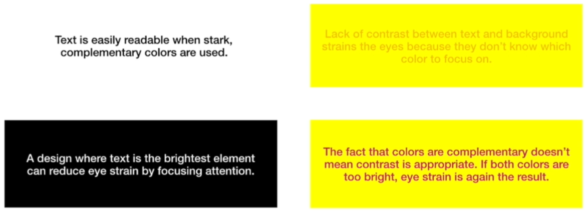
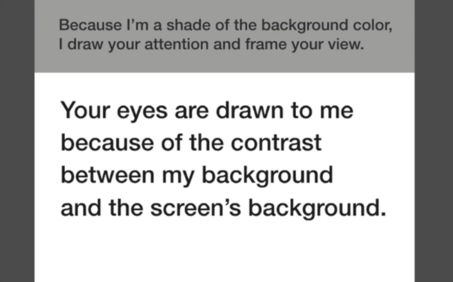
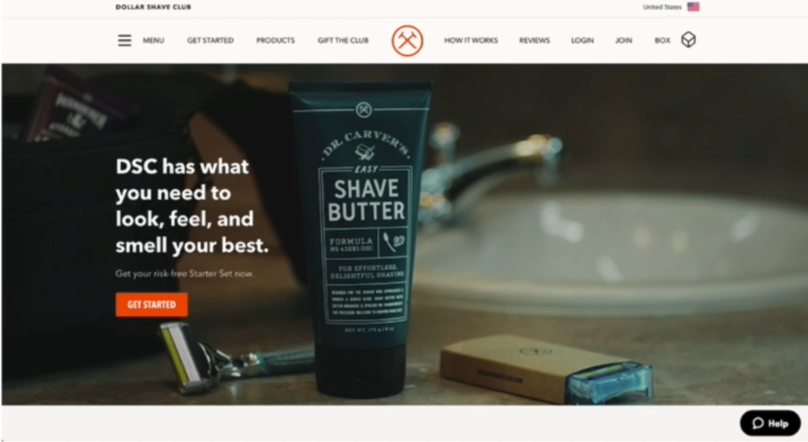

# 31 · Using Contrast to Improve Readability, Attention and Focus

Refined 15 October 2026 from the supplied Joe Natoli course notes. Original wording and captures remain preserved.

## Core principle

Readable foreground/background differences and deliberate hierarchy help information stand out.

## Application to game tools

Keep all essential labels readable; use size, spacing and emphasis to distinguish importance rather than simply fading secondary text.

## Assessment and qualification

Dark versus light theme readability depends on user, environment and typography. Complementary hues do not guarantee sufficient luminance contrast.

## Try it

Can the user read the secondary information they need to act safely?

Source: [31 Using Contrast to Improve Readability, Attention and Focus.md](file:///C:/Users/antho/OneDrive/Desktop/Notes/anthony/personal/Duke%20Tech%20Art%20Course%20Notes/17%20UI%20UX%20Design%20Principles/03%20Using%20Color%20and%20Contrast%20Appropriately/31%20Using%20Contrast%20to%20Improve%20Readability%2C%20Attention%20and%20Focus.md)

## Study detail and teaching translation

- Readability depends on the foreground/background pair and the treatment of the text. An attractive palette can still produce difficult labels.

- Emphasis should create a useful hierarchy while leaving supporting information readable. Fading all secondary labels is not a sound default.

- Teaching adaptation: inspect labels, data rows, placeholders, disabled states and focus separately. Use measured contrast as one benchmark; do not infer readability from complementary hue choices.

## Original captures

