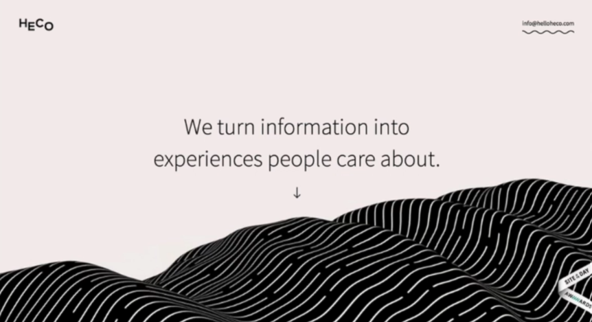

# 32 · Three Essential Functions of Contrast in UI Design

Refined 15 October 2026 from the supplied Joe Natoli course notes. Original wording and captures remain preserved.

## Core principle

Contrast can direct attention, differentiate related elements and communicate hierarchy.

## Application to game tools

Use these as three critique questions for the same tool, rather than three disconnected decoration rules.

## Assessment and qualification

“Contrast always wins” is a memorable course mantra, not an empirical universal law.

## Try it

Where should the strongest emphasis move when the tool changes state?

Source: [32 Three Essential Functions of Contrast in UI Design.md](file:///C:/Users/antho/OneDrive/Desktop/Notes/anthony/personal/Duke%20Tech%20Art%20Course%20Notes/17%20UI%20UX%20Design%20Principles/03%20Using%20Color%20and%20Contrast%20Appropriately/32%20Three%20Essential%20Functions%20of%20Contrast%20in%20UI%20Design.md)

## Study detail and teaching translation

- Use contrast to direct attention toward the next decision, distinguish elements with different roles, and communicate an order of importance.

- These functions can conflict. For example, a strongly tinted status panel may compete with the action it is intended to explain.

- Teaching adaptation: ask what should dominate in the starting, warning, ready and completed states. One fixed prominent button is not necessarily the right hierarchy for every state.

## Original captures

