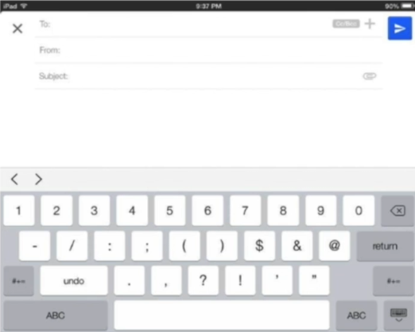
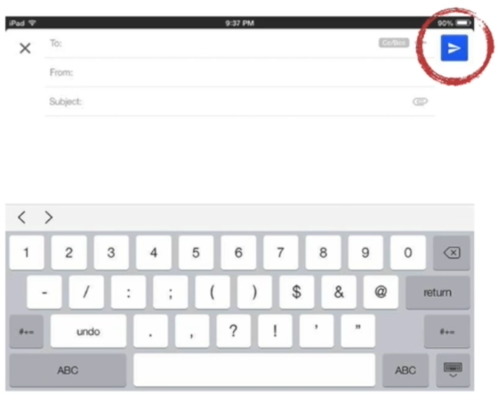
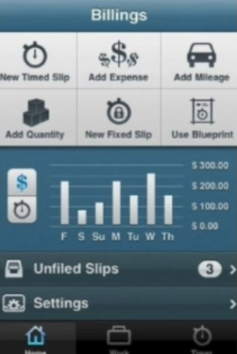
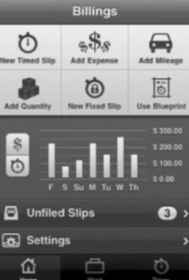
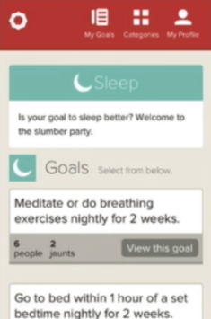
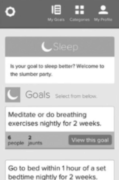
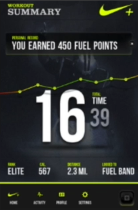
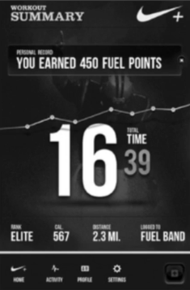

# 33 · How to Determine Appropriate Color and Contrast

Refined 15 October 2026 from the supplied Joe Natoli course notes. Original wording and captures remain preserved.

## Core principle

A grayscale check helps reveal whether hierarchy depends excessively on hue.

## Application to game tools

Compare the original and grayscale tool, then inspect actual contrast pairs and test focus and status cues.

## Assessment and qualification

Grayscale does not prove accessibility, simulate every color-vision deficiency, or measure WCAG ratios. Squinting is a separate coarse hierarchy check.

## Try it

Do the target, warning and next action remain distinguishable?

Source: [33 How to Determine Appropriate Color and Contrast.md](file:///C:/Users/antho/OneDrive/Desktop/Notes/anthony/personal/Duke%20Tech%20Art%20Course%20Notes/17%20UI%20UX%20Design%20Principles/03%20Using%20Color%20and%20Contrast%20Appropriately/33%20How%20to%20Determine%20Appropriate%20Color%20and%20Contrast.md)

## Study detail and teaching translation

- Temporarily remove hue to inspect light/dark relationships. Look for regions or states that become hard to distinguish.

- Restore color and inspect actual text/background combinations. A successful grayscale view does not establish adequate text contrast or cover all color-vision differences.

- Teaching adaptation: pair this check with the art squint test and a layout blockout. Each answers a different question; none replaces a person attempting the task.

## Original captures

