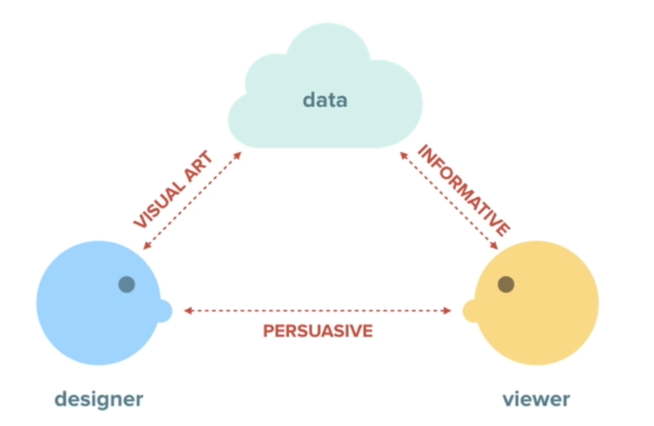
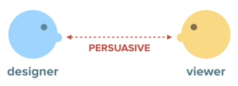
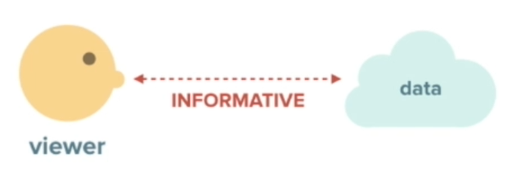
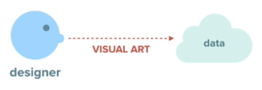
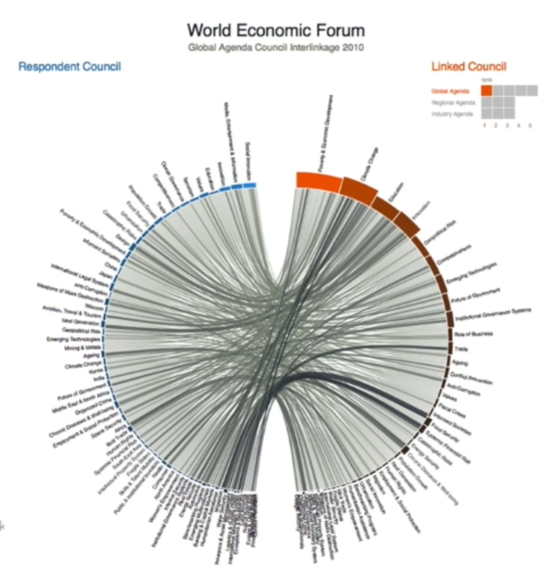
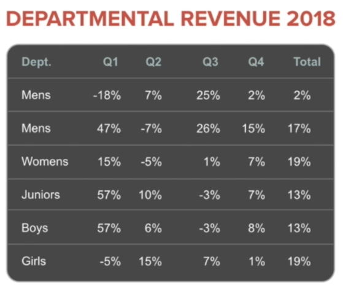
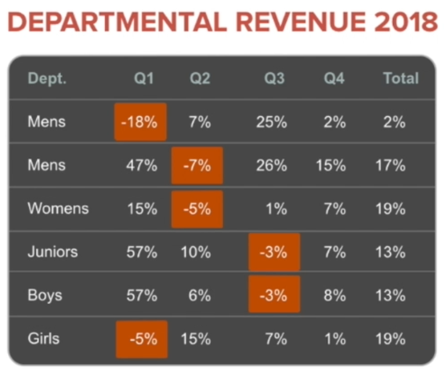

# 43 · Dealing with Data

Refined 15 October 2026 from the supplied Joe Natoli course notes. Original wording and captures remain preserved.

## Core principle

Choose data presentation according to the question the viewer must answer. Tables support exact lookup; charts support appropriate patterns and comparisons.

## Application to game tools

Show affected asset, before/after, unit, status and useful next action. Let the artist inspect details behind a summary.

## Assessment and qualification

Informative graphics still encode selection and framing choices. Avoid declaring a chart bias-free or dismissing all dense views as useless.

## Try it

Does the view answer what changed and what remains uncertain?

Source: [43 Dealing with Data.md](file:///C:/Users/antho/OneDrive/Desktop/Notes/anthony/personal/Duke%20Tech%20Art%20Course%20Notes/17%20UI%20UX%20Design%20Principles/05%20Creating%20and%20Simplifying%20Visual%20Cues/43%20Dealing%20with%20Data.md)

## Study detail and teaching translation

- Start with the question the audience needs to answer. Exact lookup, comparison, change over time and distribution are different information needs.

- Tables can preserve precise values; a suitable chart can reveal a pattern. The choice should reflect the task rather than a preference for a visually impressive graphic.

- Teaching adaptation: an asset preview needs identity, proposed change and exceptions. A production overview may benefit from thumbnails and status summaries, with exact records still available.

## Original captures

