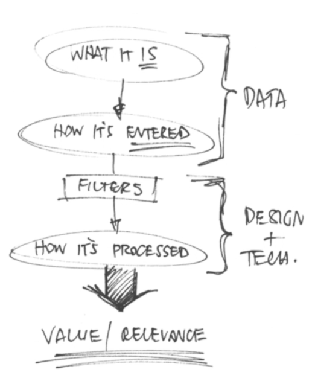
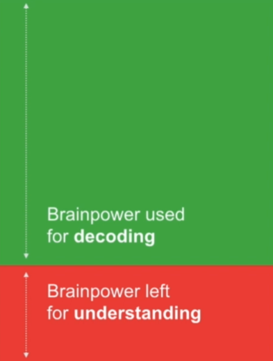

# 44 · Five Rules for Great Data Design

Refined 15 October 2026 from the supplied Joe Natoli course notes. Original wording and captures remain preserved.

## Core principle

Design data for the user’s context and decisions. Reduce irrelevant decoding work while keeping needed evidence available.

## Application to game tools

Summarize affected, skipped and blocked items, with exact records and units available for inspection.

## Assessment and qualification

“Usefulness always decreases with volume” is not universal; experts may need large structured tables. Missing, zero, untested and failed are different states.

## Try it

Which data points let this artist choose the next action?

Source: [44 Five Rules for Great Data Design.md](file:///C:/Users/antho/OneDrive/Desktop/Notes/anthony/personal/Duke%20Tech%20Art%20Course%20Notes/17%20UI%20UX%20Design%20Principles/05%20Creating%20and%20Simplifying%20Visual%20Cues/44%20Five%20Rules%20for%20Great%20Data%20Design.md)

## Study detail and teaching translation

- The source’s recurring criteria center on useful information, the user’s context, meaningful presentation and avoiding unnecessary decoding. Apply them together rather than optimizing appearance alone.

- Distinguish the essential summary from detail that should remain inspectable. The right amount of information depends on the user and decision.

- Teaching adaptation: show affected, skipped and blocked counts with a route to each record. Keep units and definitions explicit; zero, missing, untested and failed are different meanings.

## Original captures

