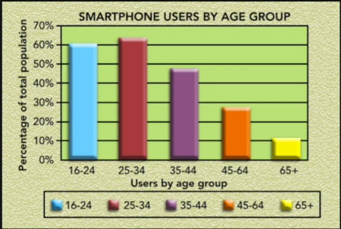
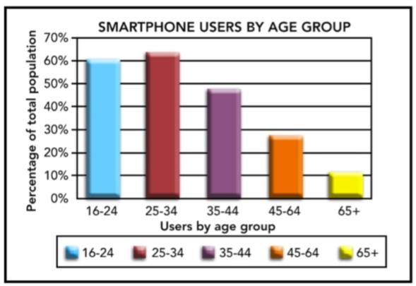

# 45 · Simplifying Visual Information Part 01

Refined 15 October 2026 from the supplied Joe Natoli course notes. Original wording and captures remain preserved.

## Core principle

Remove redundant decoration and duplicate labels when they do not support interpretation.

## Application to game tools

Simplify preview tables and charts while keeping identity, units, scales, exceptions and relevant controls.

## Assessment and qualification

Do not mechanically remove every axis, border or label. Retain them when needed for comparison or correct interpretation.

## Try it

What meaning would be lost by removing this element?

Source: [45 Simplifying Visual Information Part 01.md](file:///C:/Users/antho/OneDrive/Desktop/Notes/anthony/personal/Duke%20Tech%20Art%20Course%20Notes/17%20UI%20UX%20Design%20Principles/05%20Creating%20and%20Simplifying%20Visual%20Cues/45%20Simplifying%20Visual%20Information%20Part%2001.md)

## Study detail and teaching translation

- The chart demonstration removes a decorative background, redundant labeling, unnecessary containers, excessive category colors and misleading three-dimensional effects.

- It then reduces the prominence of guides and labels relative to data, and uses direct values where they make the comparison understandable.

- Teaching adaptation: simplify the preview table by removing visual repetition, not required evidence. Preserve asset names, before/after meaning, units, exceptions and any scale needed for honest comparison.

## Original captures

