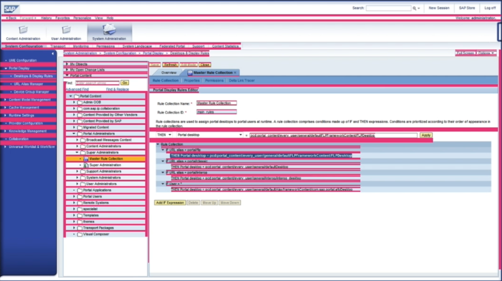
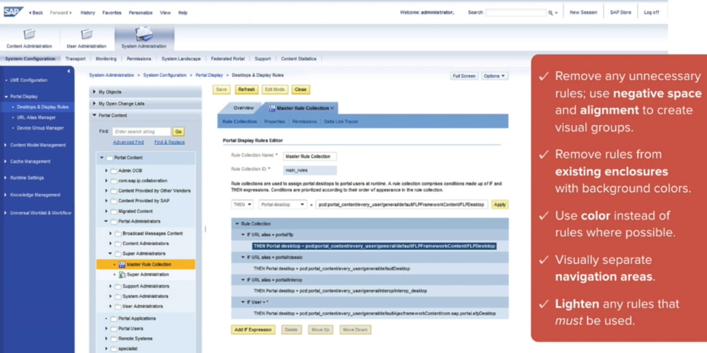
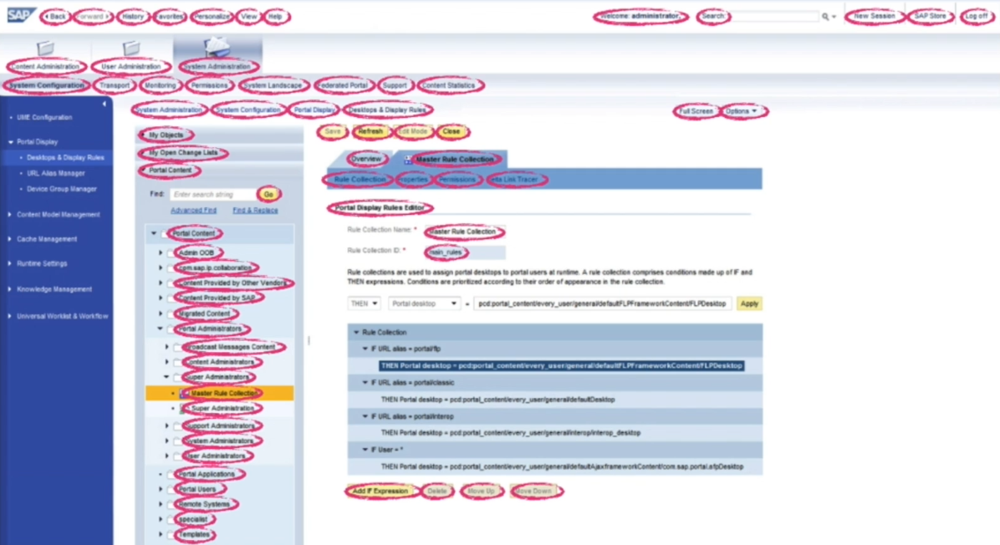
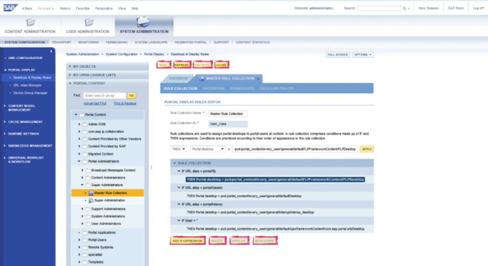
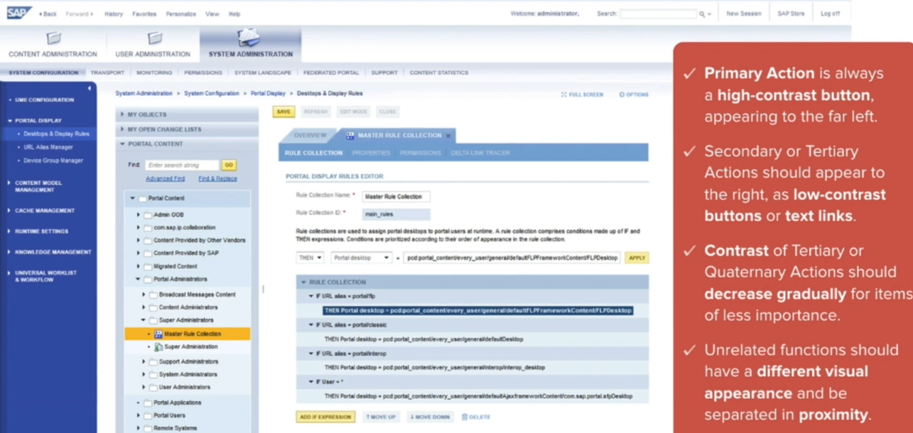

# 46 · Simplifying Visual Information Part 02

Refined 15 October 2026 from the supplied Joe Natoli course notes. Original wording and captures remain preserved.

## Core principle

Simplify crowded interfaces by clarifying groups, label roles and action hierarchy.

## Application to game tools

Use predictable spacing and readable data; distinguish reset, preview and apply by role and current state.

## Assessment and qualification

All-caps labels, low-contrast text, text-only secondary actions and removing every container are examples, not universal prescriptions.

## Try it

Does a quieter control remain visibly actionable and keyboard accessible?

Source: [46 Simplifying Visual Information Part 02.md](file:///C:/Users/antho/OneDrive/Desktop/Notes/anthony/personal/Duke%20Tech%20Art%20Course%20Notes/17%20UI%20UX%20Design%20Principles/05%20Creating%20and%20Simplifying%20Visual%20Cues/46%20Simplifying%20Visual%20Information%20Part%2002.md)

## Study detail and teaching translation

- The interface demonstration first regularizes spacing: outer margins, paragraph separation and padding inside controls and containers.

- It removes redundant rules where spacing or an existing surface already establishes a group. Necessary boundaries remain, and labels are distinguished from values without losing readability.

- It differentiates primary, secondary and less frequent actions, and separates unrelated operations. The particular yellow buttons, all-caps labels and text-link choices are examples rather than universal rules.

- Teaching adaptation: preserve recognizable supporting buttons, keep Reset away from the forward action, and let current readiness determine which action receives emphasis.

## Original captures

