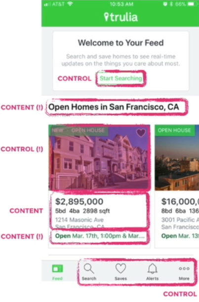
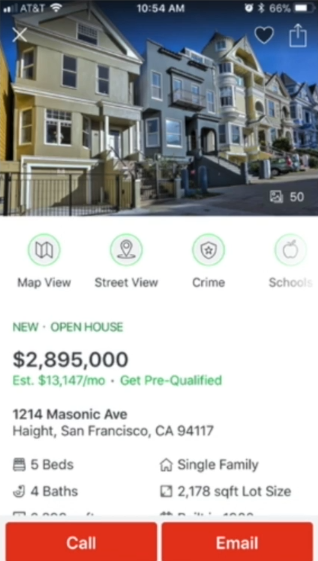
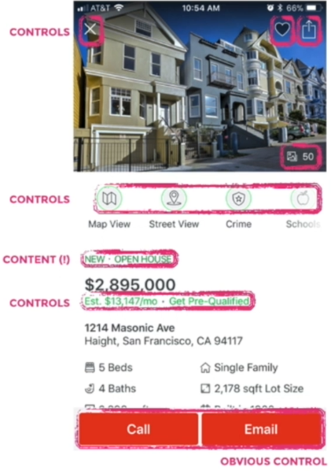

# 47 · Separating Content from Controls Part 01

Refined 15 October 2026 from the supplied Joe Natoli course notes. Original wording and captures remain preserved.

## Core principle

Content and controls need distinct, consistent signals so users can predict what is interactive.

## Application to game tools

A read-only preview row should not look like an editable field. Buttons need visible labels and state cues.

## Assessment and qualification

Content may legitimately be interactive, such as asset rows that open details. The requirement is clear affordance and consistent behavior, not physical separation of all content.

## Try it

Which elements do users expect to click, and what actually happens?

Source: [47 Separating Content from Controls Part 01.md](file:///C:/Users/antho/OneDrive/Desktop/Notes/anthony/personal/Duke%20Tech%20Art%20Course%20Notes/17%20UI%20UX%20Design%20Principles/05%20Creating%20and%20Simplifying%20Visual%20Cues/47%20Separating%20Content%20from%20Controls%20Part%2001.md)

## Study detail and teaching translation

- Audit the cues that imply interactivity: button shapes, link styling, icons, consistent state changes and learned conventions. A user should be able to make a reasonable prediction before clicking.

- Do not style a static heading like a button or reuse the same strong cue inconsistently for clickable and non-clickable content.

- Teaching adaptation: a preview can be read-only while an asset row opens details. Make that distinction discoverable. When users call a view “busy,” investigate competing priorities rather than assuming a specific cause.

## Original captures

