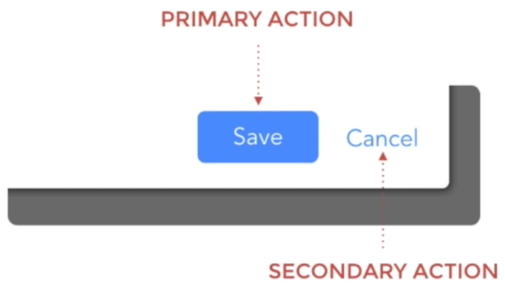
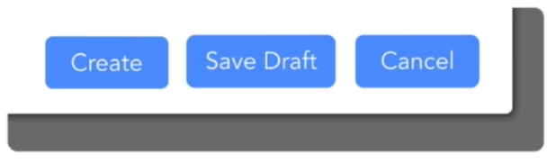
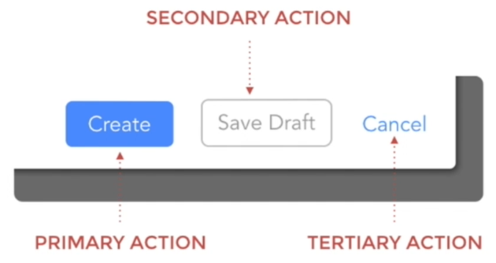
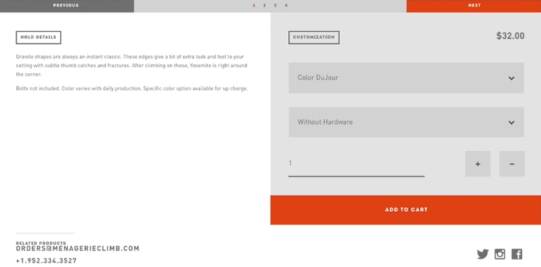
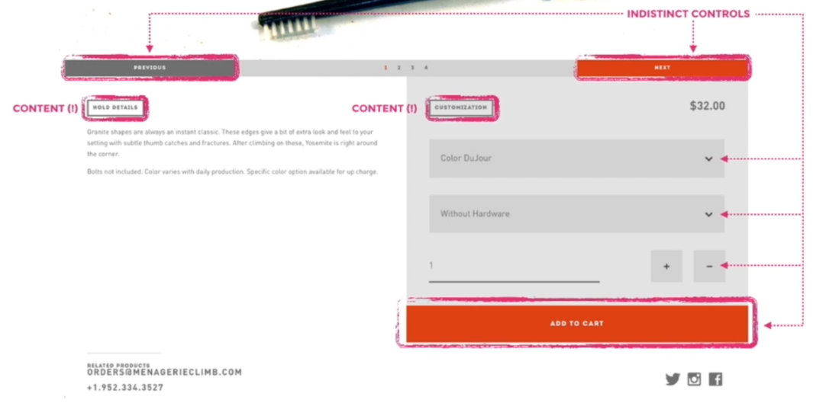
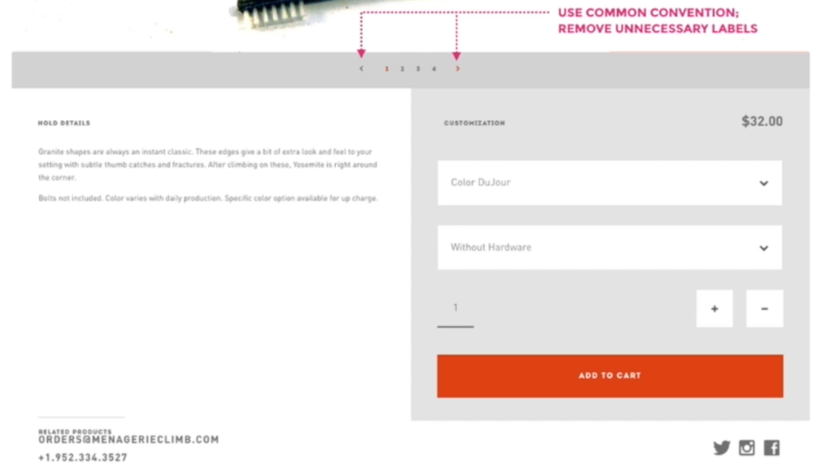
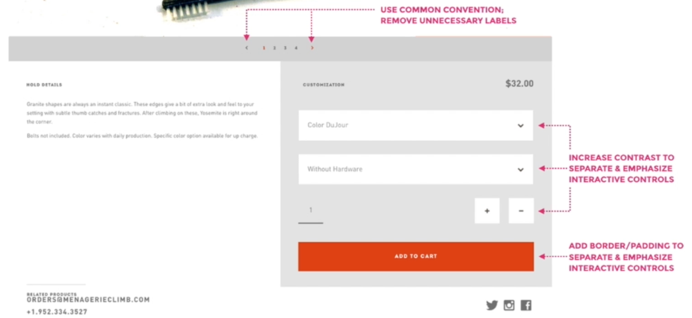
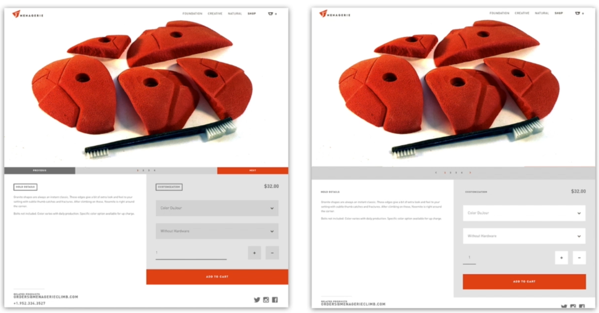

# 48 · Separating Content from Controls Part 02

Refined 15 October 2026 from the supplied Joe Natoli course notes. Original wording and captures remain preserved.

## Core principle

Differentiate primary, secondary and consequential actions without losing discoverability or familiar conventions.

## Application to game tools

Keep Reset away from the forward workflow; emphasize Preview until a reviewed plan allows Apply. Preserve recognizable secondary buttons.

## Assessment and qualification

Do not teach that Cancel must always be a text link, or that full-width buttons are always wrong. The final source mantra number conflicts with recap 49; use topic names.

## Try it

Can an unfamiliar artist predict the consequence of each action?

Source: [48 Separating Content from Controls Part 02.md](file:///C:/Users/antho/OneDrive/Desktop/Notes/anthony/personal/Duke%20Tech%20Art%20Course%20Notes/17%20UI%20UX%20Design%20Principles/05%20Creating%20and%20Simplifying%20Visual%20Cues/48%20Separating%20Content%20from%20Controls%20Part%2002.md)

## Study detail and teaching translation

- Actions differ in priority and consequence. A forward action, draft/save operation and cancellation need a clear hierarchy, but all must remain recognizable and operable.

- The source demonstrates stronger primary emphasis, quieter supporting actions, conventional navigation, clearer field boundaries and removing button-like framing from headings.

- Teaching adaptation: use host conventions and explicit verbs. Keep disabled, secondary and destructive actions conceptually distinct; a neutral appearance does not mean a control is disabled.

- The final mantra number in this lesson conflicts with the recap. Use “separate content from controls” as the topic label rather than repeating the inconsistent number.

## Original captures

